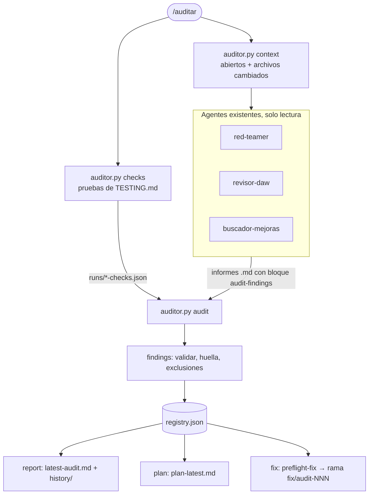
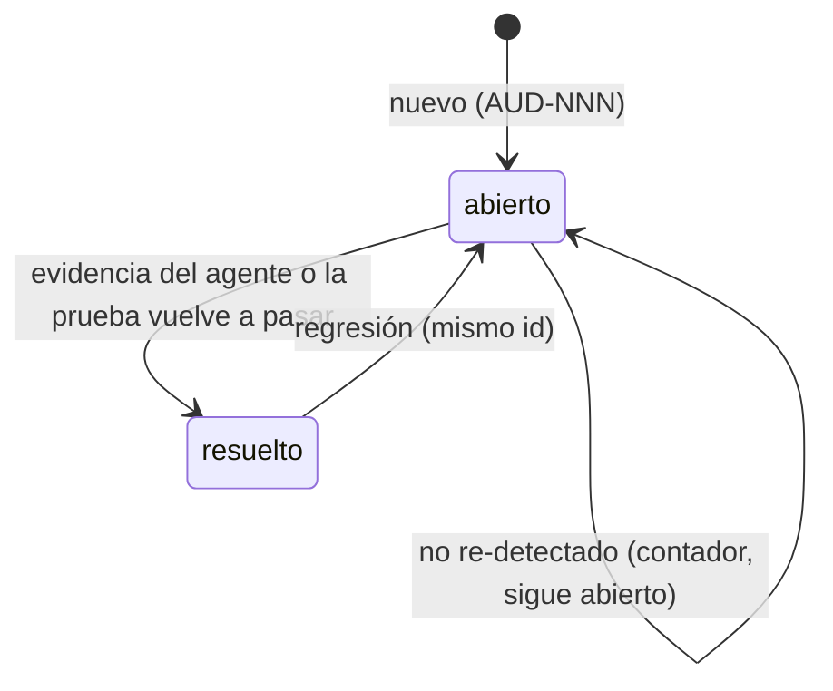

# Project Auditor

Auditor continuo de Python Learning Dashboard: ejecuta las pruebas del proyecto, coordina a los agentes
de revisión que ya existen y guarda sus hallazgos en un **registro con histórico**. Así cada auditoría
dice qué es nuevo, qué se ha resuelto, qué ha empeorado y qué sigue igual, sin repetir el mismo
informe cada vez.

- Se lanza con `/auditar` en Claude Code ([`.claude/commands/auditar.md`](../.claude/commands/auditar.md)).
- El motor es `scripts/audit/` (Python 3.11+, **solo librería estándar**).
- La configuración es [`project-auditor.toml`](../project-auditor.toml).
- Los informes van a `.claude/informes/audit/`, **fuera de Git**: el repositorio es público y un
  hallazgo de seguridad publicado es una vulnerabilidad divulgada (DEC-022).

## 1. Por qué está hecho así

El encargo original pedía siete motores separados y una capa para cambiar de proveedor de IA. En este
repositorio, la mayor parte de eso ya existía:

| El encargo pedía | Aquí ya lo hacía | Qué añade el auditor |
|---|---|---|
| Motor de seguridad | `red-teamer` (OWASP WSTG, ASVS, CWE, CVSS; RT-NNN) | Une sus hallazgos con los demás |
| Motor de análisis con IA | `revisor-daw` y `buscador-mejoras` (MJ-NNN) | Contexto mínimo y esquema común |
| Motor de tests y estático | `docs/TESTING.md`, CI, ruff, pip-audit, npm audit | Registro fiable de qué se ejecutó y qué no |
| Ejecución de correcciones | `mejorador-web` (una mejora por rama) | Clasificación SAFE FIX / APPROVAL REQUIRED |
| Reportes y recomendaciones | Informes sueltos en `.claude/informes/` | Registro, comparación, puntuación y plan |

Se decidió **reutilizar** (D1 del plan) en lugar de duplicar: menos código, la numeración RT y MJ se
conserva, y se respetan `CLAUDE.md` (sin APIs de pago) y DEC-010 (sin dependencias nuevas). El «motor
de IA» es Claude Code con esos agentes. No hace falta abstraer el proveedor: si un día se quiere un
modelo local (Ollama), basta con otro agente que escriba el mismo bloque `audit-findings`.

## 2. Arquitectura



| Módulo (`scripts/audit/pld_audit/`) | Responsabilidad |
|---|---|
| `config.py` | Lee y valida `project-auditor.toml`; dice qué campo está mal |
| `checks.py` | Ejecuta las pruebas sin shell, con tiempo máximo, y guarda la salida sin secretos |
| `findings.py` | Esquema, validación, alias en español y huella estable de cada hallazgo |
| `registry.py` | Estados entre auditorías; escritura atómica |
| `report.py` | Informe Markdown y puntuación heurística |
| `plan.py` | Plan de corrección por prioridad |
| `fix.py` | Clasificación SAFE FIX / APPROVAL REQUIRED / FORBIDDEN y comprobaciones de Git |

`scripts/audit/auditor.py` es la CLI que los une. Las dependencias van en un solo sentido:
`auditor → (report, plan, fix) → (registry, findings, checks) → config`.

## 3. Instalación

No hay nada que instalar aparte de lo que ya pide [`TESTING.md`](TESTING.md): Python 3.11+ con
`backend/requirements-dev.txt` y, para las pruebas del frontend, Node 22 y `npm ci`. Opcional:
`pip install pip-audit` (si falta, esa prueba sale como «no ejecutada», no como aprobada).

```bash
python scripts/audit/auditor.py checks --depth quick   # comprobar que funciona
```

## 4. Uso

En Claude Code:

| Comando | Qué hace |
|---|---|
| `/auditar` | READ ONLY: pruebas + agentes + registro + informe |
| `/auditar security,dependencies` | Solo esas categorías |
| `/auditar --depth quick` | Solo pruebas, sin agentes (gratis y rápido) |
| `/auditar plan` | Plan de corrección desde el registro |
| `/auditar safe-fix AUD-007` | Corrige un hallazgo SAFE FIX en su rama, con pruebas antes y después |

La CLI también funciona sola (por ejemplo, en una terminal de PyCharm):

```bash
python scripts/audit/auditor.py checks [--depth quick|standard|deep] [--only a,b] [--allow-writes] [--strict]
python scripts/audit/auditor.py context [--since <ref>]
python scripts/audit/auditor.py audit --scope all --checks <checks.json> informe1.md informe2.md
python scripts/audit/auditor.py plan [--min-priority P1]
python scripts/audit/auditor.py preflight-fix AUD-007 [--create-branch]
python scripts/audit/auditor.py compare-checks antes.json despues.json
```

Archivos que genera en `.claude/informes/audit/`:

| Archivo | Contenido |
|---|---|
| `latest-audit.md` | El último informe |
| `history/<id>.md` | Cada informe, para siempre |
| `runs/<id>.json` | Resumen y resultado de cada prueba de esa auditoría |
| `registry.json` | Todos los hallazgos con su estado e historial |
| `plan-latest.md` | El último plan |

## 5. Modos

| Modo | Qué cambia | Cómo |
|---|---|---|
| **READ ONLY** (predeterminado) | Nada del proyecto | `/auditar` |
| **PLAN** | Nada | `/auditar plan` |
| **SAFE FIX** | Una rama nueva y el cambio mínimo | `auditor.mode = "safe-fix"` en la configuración **y** `/auditar safe-fix AUD-NNN` |
| **APPROVAL REQUIRED** | Nada hasta que apruebes | Lo decide `fix.classify` |

Un hallazgo es SAFE FIX solo si cumple **todo** esto: severidad ≤ `safe_fix.max_severity`, riesgo de la
solución en `allowed_fix_risk`, categoría fuera de `approval_categories`, ningún archivo en
`approval_paths` (autenticación, permisos, base de datos, migraciones, routers de la API, Docker,
Render, CI, service worker…) y que no venga de una prueba que falla (eso se investiga primero). Los
archivos de `forbidden_paths` (JSON generados de `frontend/data/` y secretos) son **FORBIDDEN**: no los
toca nadie a mano.

Antes de crear la rama, `preflight-fix` comprueba que no hay cambios sin confirmar (no se pisa el
trabajo del usuario), que la rama no existe y que el hallazgo sigue abierto. La rama es la copia de
seguridad. `compare-checks` falla si alguna prueba que pasaba deja de pasar. Ningún modo hace push,
merge ni despliegue.

## 6. Configuración

Todo está comentado en [`project-auditor.toml`](../project-auditor.toml):

| Sección | Para qué |
|---|---|
| `[auditor]` | Modo, carpeta de salida, severidad mínima, profundidad, frecuencia, categorías y exclusiones |
| `[limits]` | Agentes por auditoría, tiempo máximo por prueba y líneas de salida que se guardan |
| `[score]` | Pesos de la puntuación |
| `[safe_fix]` | Reglas de SAFE FIX y rutas protegidas o prohibidas |
| `[[checks]]` | Cada prueba: `cmd` (lista, sin shell), `cwd`, `category`, `depth`, `requires*`, `writes_files` |

Para añadir una prueba, añade un bloque `[[checks]]`. Si escribe archivos, marca `writes_files = true`:
solo correrá con `--allow-writes`.

## 7. Esquema de un hallazgo

Los agentes añaden al final de su informe un bloque así (también se acepta un `.json` con el mismo
contenido):

````markdown
```json audit-findings
{
  "findings": [{
    "title": "…", "severity": "CRITICAL|HIGH|MEDIUM|LOW|INFO", "priority": "P0|P1|P2|P3",
    "category": "una de auditor.categories", "file": "ruta/del/archivo", "line": 42,
    "function": "opcional", "files": ["opcional: otros archivos que tocaría la solución"],
    "description": "…", "evidence": "ruta:línea, comando y salida",
    "impact": "…", "likelihood": "high|medium|low", "fix": "…", "effort": "S|M|L",
    "fix_risk": "high|medium|low", "regression_test": "…",
    "kind": "fact|suspicion|recommendation", "key": "causa-raiz-estable", "ref": "RT-012"
  }],
  "resolved": [{"id": "AUD-003", "evidence": "por qué ya no se reproduce"}],
  "positives": ["algo que está bien hecho"]
}
```
````

- Se aceptan los valores en español (`Alta`, `hecho`, `sospecha`, `media`…).
- Un `fact` o una `suspicion` sin evidencia se rechaza. Una `recommendation` no puede ser CRITICAL ni
  HIGH (una opinión no es una vulnerabilidad), y una `suspicion` no puede ser CRITICAL.
- Lo que se rechaza aparece en «Límites de esta auditoría» con su motivo. Nunca se descarta en silencio.
- La **huella** es categoría + archivo + `key`: si cambia la redacción o la línea, sigue siendo el
  mismo hallazgo y conserva su `AUD-NNN`.

## 8. Estados y comparación



Un hallazgo **solo se resuelve con evidencia**. Que un agente no lo repita no basta, porque los
modelos no son deterministas: queda como «no re-detectado» y el informe lo muestra para verificarlo. En
el informe solo se detalla lo nuevo, lo cambiado y las regresiones. Lo que sigue igual va en una tabla
de una línea por hallazgo.

**Ahorro de coste:** `context` pasa a cada agente solo sus hallazgos abiertos y los archivos cambiados
desde la última auditoría. Si no ha cambiado nada y no toca auditar por frecuencia, `/auditar` solo
ejecuta las pruebas. `--depth quick` no usa ningún agente.

## 9. Puntuación

**Project Health Score** (0-100): una **evaluación heurística**, no una métrica objetiva. Se parte de
100 y se resta, por defecto: 25 por cada CRITICAL abierto, 10 por HIGH, 4 por MEDIUM y 1 por LOW, 10
por cada prueba que falla y 2 por cada prueba sin ejecutar (lo no comprobado es incertidumbre). Los
pesos están en `[score]`. Las bandas son: ≥ 90 sólido · ≥ 75 bueno · ≥ 50 con riesgos · < 50 en riesgo.

## 10. Seguridad del propio auditor

- Las pruebas se lanzan con una lista de argumentos, **sin shell**, y con tiempo máximo.
- La salida que se guarda pasa por `redact()`, que oculta valores con forma de `token=`, `password:`…
- El texto de los agentes se escapa antes de entrar en el informe: no puede inyectar HTML, y una
  evidencia con ``` no rompe el bloque de código.
- No lee `.env` ni secretos. Esas rutas son FORBIDDEN para SAFE FIX.
- El registro se escribe de forma atómica: o queda el nuevo entero o el anterior.

## 11. CI/CD

Los tests del auditor (`backend/tests/test_audit_engine.py` y `test_audit_report.py`) corren en el job
`backend` de `ci.yml`, como el resto, y ruff ya revisa `scripts/`. No se ha añadido ningún workflow:

- La parte determinista (las pruebas) **ya** bloquea los PR en CI, y un segundo job las repetiría.
- La parte de IA en CI necesitaría una API de pago, prohibida en `CLAUDE.md`.
- Bloquear merges por hallazgos de los agentes iría contra la regla de no bloquear por recomendaciones
  subjetivas.

Si algún día se quiere en CI: un job `workflow_dispatch` que ejecute `auditor.py checks --strict` y
suba el JSON como artefacto. Nada de comentarios automáticos con hallazgos en un repositorio público.

## 12. Ejemplos

En [`docs/auditor/ejemplos/`](auditor/ejemplos/) hay una primera auditoría, una segunda que se compara con
ella y un plan. Están generados con la CLI a partir de los informes **ficticios** de
`scripts/audit/fixtures/`, que también usan los tests.

## 13. Limitaciones conocidas

- La calidad de los hallazgos de IA depende de los agentes. El auditor valida su forma y exige
  evidencia, pero no comprueba que la evidencia sea cierta: eso lo hace quien revisa el informe.
- La huella depende de que el agente reutilice el `key`. Si lo cambia, el mismo problema sale como
  nuevo y el antiguo como «no re-detectado».
- Mover un archivo cambia la huella de sus hallazgos.
- No hay planificador: la frecuencia solo sirve para avisar y para decidir si saltarse a los agentes.
  Para auditar de forma periódica, usa una tarea programada de Claude Code que lance `/auditar`.
- Las e2e (`depth = "deep"`) tardan varios minutos y necesitan `--allow-writes`.
- No hay integración con issues de GitHub, a propósito (repositorio público).

## 14. Roadmap

1. Marcar `AUD-NNN` en el mensaje del commit de SAFE FIX y resolverlo con ese commit como evidencia.
2. `auditor.py checks --changed`: ejecutar solo las pruebas de `docs/TESTING.md` § «Qué ejecutar según
   lo que cambies» que tocan los archivos cambiados.
3. Gráfico de la puntuación por auditoría en el informe, a partir de `registry.json`.
4. Agente opcional con Ollama local para auditar sin conexión, con el mismo bloque `audit-findings`.
5. Exportar un resumen sin datos de seguridad, apto para publicar en la memoria del proyecto.
