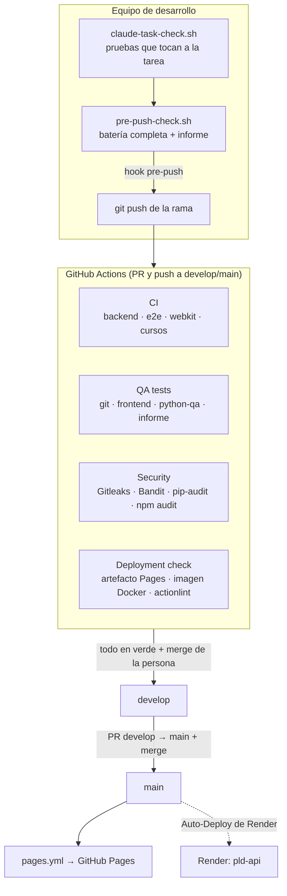

# Arquitectura de CI/CD

Qué se comprueba, dónde y cuándo, desde el equipo de quien desarrolla hasta la web publicada.
Uso diario en [QA_GUIDE.md](QA_GUIDE.md); ramas y protección en [GIT_WORKFLOW.md](GIT_WORKFLOW.md).

## Punto de partida (auditoría del 05/11/2026, commit `2dc7ff2`)

Antes del entorno QA el repositorio ya tenía una base sólida, que se mantiene sin cambios de
comportamiento:

- `ci.yml`: ruff, pytest con cobertura del 100 %, pip-audit, contenido generado al día, migraciones en
  PostgreSQL, tests unitarios del frontend, npm audit, e2e con Playwright y axe (Chromium), prueba de
  humo en WebKit y cursos de DAW comprobados ejecutando el código. Solo en push a `main` y en PR.
- `pages.yml`: publica `frontend/` en GitHub Pages con cada push a `main` (con la CSP de producción).
- Seguridad en el código: CSP en cada página, cabeceras de seguridad en la API, cookie `__Host-`
  HttpOnly, límites de peticiones y de tamaño, pruebas de aislamiento entre cuentas.

Lo que faltaba y añade el entorno QA: rama `develop`, Dependabot (se había quitado en `5dcea0b`),
Bandit, Gitleaks, validación HTML y CSS, comprobación de imports, exports, Workers y recursos del
frontend, contrato entre frontend y backend, 401 automático en todas las rutas protegidas,
verificación del artefacto de Pages y de la imagen Docker, script pre-push, control de tareas e
informe de QA. Resultados de la auditoría: Gitleaks encontró 3 coincidencias en el historial, las 3
falsos positivos revisados (contraseñas de test y un marcador de `.env.docker.example`, en
`.gitleaks.toml`); Bandit no encontró nada de severidad media o alta en `backend/app` (4 bajas,
falsos positivos de nombres de eventos) y 9 medias en `scripts/` (herramientas de build con datos
propios: se informan, no bloquean); pip-audit y npm audit, sin vulnerabilidades.

## Capas



Todas las comprobaciones viven en `scripts/qa/checks.sh`: el script local y los workflows llaman a
las mismas funciones, así que una regla nueva se añade una sola vez y funciona igual en los dos sitios.

## Workflows

| Workflow | Cuándo | Trabajos | Qué aporta |
|---|---|---|---|
| `ci.yml` (existente) | PR, push a `main` y `develop` | `backend`, `e2e`, `webkit`, `cursos` | La batería principal. Solo se le ha añadido `develop` al push |
| `qa-tests.yml` | PR, push a `main` y `develop`, manual | `git`, `frontend`, `python-qa`, `report` | Lo que `ci.yml` no hacía (ver abajo), sin repetir lo que ya hace |
| `security.yml` | PR, push a `main` y `develop`, **cada lunes**, manual | `scan` | Secretos, análisis estático, dependencias y pruebas de seguridad |
| `deployment-check.yml` | PR, push a `main` y `develop`, manual | `pages-artifact`, `backend-image`, `config` | Que lo que se publicaría está bien, sin publicar nada |
| `pages.yml` (existente) | Push a `main` | `deploy` | Publica la web. Sin cambios |

### `qa-tests.yml`

- **git**: nombre de la rama del PR (y acepta `develop → main`), archivos modificados (pruebas
  borradas o saltadas, cobertura rebajada, JSON generados a mano) y conflictos con la base.
- **frontend**: `frontend_static.mjs`, html-validate, stylelint, tests del validador y pruebas en
  Chromium (carga de módulos, Web Worker de Python con un Pyodide simulado y con el real, cierre de red
  del Worker).
- **python-qa**: ruff sobre `tests/` (que `ci.yml` no lintaba), `tests/backend`, `tests/integration` y
  `tests/security`.
- **report**: junta los resultados de los tres trabajos en `latest-report.md`, que se ve en el resumen
  de la ejecución y se descarga como artefacto `qa-report`. Falla si el resultado es FAIL.

### `security.yml`

`scripts/qa/security_scan.sh` con las herramientas en versiones fijas: pip-audit 2.10.1, Bandit 1.9.4
y Gitleaks 8.28.0 (binario oficial comprobado con su SHA-256, sin acciones de terceros). En un PR,
Gitleaks revisa los commits del PR; en `main`, `develop` y cada lunes, todo el historial. pip-audit y
npm audit también están en `ci.yml`: aquí se repiten porque la ejecución semanal necesita sus propios
datos (las vulnerabilidades se publican aunque el código no cambie). Cuestan unos 30 segundos.

### `deployment-check.yml`

- **pages-artifact**: copia `frontend/`, aplica `production_csp.py` como `pages.yml` y verifica la
  copia (`verify_pages_artifact.py`: archivos necesarios, CSP sin `localhost`, cada entrada de
  `precache.js` presente, sin `.env`, claves, `node_modules`, `__pycache__` ni enlaces), vuelve a pasar
  el validador del frontend sobre la copia y sube el resultado como artefacto de 3 días.
- **backend-image**: `docker build` como Render, arranca el contenedor con SQLite temporal y un
  secreto de un solo uso, y comprueba `/api/health`, las cabeceras de seguridad, que `/docs` no se
  publica y que el proceso no corre como root.
- **config**: actionlint (binario con SHA-256) sobre todos los workflows y presencia de los archivos
  que necesita el despliegue (`render.yaml`, Dockerfile, páginas, service worker…).

## Decisiones

- **No se duplica `ci.yml`**: se ha mantenido como está (solo se añade `develop`), y los workflows
  nuevos solo hacen lo que no hacía. El PR #103 (abierto) también cambia `ci.yml` y `CLAUDE.md`; los
  cambios de este entorno están en líneas distintas para no chocar con él.
- **Acciones fijadas por SHA** con el número de versión en un comentario. Dependabot
  (`github-actions`) las actualiza. `ci.yml` y `pages.yml` siguen con etiquetas (`@v7`) como estaban;
  se pueden fijar igual en un cambio aparte.
- **Permisos mínimos**: `contents: read` en todos los workflows nuevos; ninguno usa secretos ni
  escribe en el repositorio.
- **Sin ejecuciones repetidas**: solo `pull_request` y push a `main`/`develop` (no cada push a una
  rama de trabajo), y un push nuevo al mismo PR cancela la ejecución anterior (`concurrency`).
- **QA_STRICT en CI**: si una herramienta no se puede ejecutar, el paso falla en vez de salir como
  SKIP. En local, un SKIP se marca y deja el resultado en WARNING, nunca en PASS.
- **Sin CodeQL propio**: GitHub ofrece la configuración por defecto gratis en repositorios públicos
  y un workflow propio choca con ella. Bandit, el validador del frontend y las pruebas de seguridad
  cubren el análisis estático; activar CodeQL queda como paso manual (GIT_WORKFLOW.md).
- **Nada contra producción**: las pruebas usan SQLite en memoria, mocks y servidores locales.
  Ninguna llama a Render, Neon, Google ni Brevo.

## Estructura

```
.github/
  dependabot.yml                 # pip, npm, docker y github-actions → develop
  workflows/
    ci.yml                       # existente (+ develop)
    pages.yml                    # existente
    qa-tests.yml  security.yml  deployment-check.yml
scripts/qa/
  lib.sh                         # run_step: logs, PASS/FAIL/WARN/SKIP, diagnóstico
  checks.sh                      # todas las comprobaciones (local y CI)
  pre-push-check.sh              # batería completa antes del push
  claude-task-check.sh           # control de cada tarea
  security_scan.sh               # análisis de seguridad
  ci-step.sh                     # un paso de checks.sh dentro de GitHub Actions
  install-hooks.sh               # hook pre-push local
  frontend_static.mjs            # validación estática del frontend
  verify_pages_artifact.py       # verificación del artefacto de Pages
  report.py                      # reports/qa/latest-report.md
tests/
  frontend/                      # validador, HTML/CSS, Web Workers (Playwright)
  backend/                       # contrato OpenAPI, 401, errores, dependencias
  integration/                   # frontend ↔ backend, CORS, CSP, variables, Google
  security/                      # CSP, secretos, cookies, autorización, entradas
  conftest.py  pytest.ini        # reutilizan backend/tests/conftest.py
reports/qa/                      # informes generados (no se versionan)
.gitleaks.toml  .htmlvalidate.json  .stylelintrc.json
```
