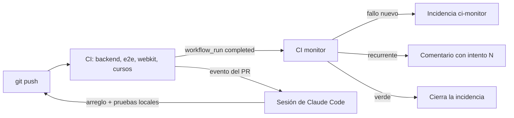

# Monitorización de CI/CD

Cada subida a GitHub queda vigilada hasta que GitHub Actions termina. Hay tres piezas, y cada una
cubre un hueco de las otras:

| Pieza | Dónde corre | Qué hace | Sigue funcionando sin Claude Code |
|---|---|---|---|
| `ci-monitor.yml` + `scripts/ci-monitor/ci_monitor.py` | GitHub Actions | Diagnostica cada ejecución de «CI» y avisa con una incidencia | Sí |
| Sesión de Claude Code suscrita al PR | La nube de Claude | Lee el fallo, lo corrige, prueba en local y sube el arreglo | Mientras la sesión exista |
| `scripts/ci-monitor/monitor.sh` | Tu equipo | Espera a las ejecuciones de un commit y muestra el diagnóstico | Sí (a mano) |



## 1. Cómo detecta las subidas

`ci.yml` se ejecuta en cada `push` a `main` y en cada pull request. Cuando termina una ejecución,
GitHub lanza `ci-monitor.yml` (evento `workflow_run`) con el id de esa ejecución. Así el monitor
trabaja siempre sobre la ejecución concreta que ha terminado, con su rama y su commit, y no
confunde ejecuciones de commits anteriores.

## 2. Cómo obtiene los logs

`ci_monitor.py report --run-id N` usa la API REST de GitHub con el `GITHUB_TOKEN` del workflow:
la ejecución (`/actions/runs/N`), sus jobs y, de cada job fallido, su log
(`/actions/jobs/<id>/logs`) y el nombre del paso que falló. Solo usa la biblioteca estándar de
Python: no instala nada.

## 3. Cómo diagnostica

- Quita marcas de tiempo y colores y busca el **primer error real** (`Error:`, `##[error]`,
  `Traceback`, el primer test fallido de Playwright con su mensaje…).
- Lo **clasifica**: error de código o de un test, de configuración (permisos de un navegador,
  navegador sin instalar, módulo que falta, workflow inválido) o **externo** (red, npm o PyPI
  caídos, límite de la API, runner apagado).
- Saca las **áreas** (Backend, E2E, WebKit, Cursos, Dependencias, Seguridad…) del job, del paso y
  del error.
- Calcula una **firma** del job, el test y el error sin números ni ids, para reconocer el mismo
  fallo en otra ejecución.

Y decide:

| Resultado de la ejecución | Decisión | Qué hace |
|---|---|---|
| success sin incidencia abierta | validada | Solo el resumen del job |
| success con incidencia abierta de la rama | corregido | Comenta y cierra la incidencia |
| cancelled / skipped | cancelada | Solo el resumen: no es un fallo |
| failure de un commit que ya no es el último de la rama | obsoleta | Solo el resumen |
| failure sin incidencia, o con un error distinto | nuevo | Abre la incidencia «CI falla en `<rama>`» o comenta en la que hay |
| failure con las mismas firmas ya anotadas | recurrente | Comenta con el número de intento |

El resumen se ve también en la pestaña *Summary* de la ejecución de «CI monitor».

## 4. Cómo se aplican las correcciones

El workflow **no cambia código**: solo diagnostica y avisa. Corregir código desde Actions con un
modelo de IA necesitaría una clave de API de pago, y el proyecto solo usa herramientas gratuitas.

Las correcciones las hace Claude Code, con las reglas de la sección «CI» de `CLAUDE.md`:

1. Cada sesión que abre o actualiza un PR se suscribe a su actividad: los fallos de CI la despiertan.
2. Lee el log del job fallido, reproduce el fallo en local, corrige la causa con el cambio mínimo y
   añade una prueba de regresión.
3. Pasa las pruebas de `docs/TESTING.md` que tocan, revisa `git diff --check` y sube un commit
   nuevo (nunca `push --force` ni `git add .`).
4. Como mucho **3 ciclos** por incidencia y nunca la misma solución dos veces. Si el fallo es
   externo, no toca el código: lo dice y propone relanzar. Si necesita un secreto, un permiso o una
   decisión de arquitectura, para y te lo pregunta.

Si la sesión ya no existe, la incidencia queda abierta: abre una sesión nueva en la rama y pídele
«arregla la CI de esta incidencia».

## 5. Cómo te informa

- **Incidencias de GitHub** con la etiqueta `ci-monitor` (una por rama): GitHub te avisa por email y
  en la campana de cada incidencia y comentario. Ver todas:
  `https://github.com/Marbi8891/python-learning-dashboard/issues?q=label%3Aci-monitor`.
- **En el hilo del proyecto**, la sesión de Claude Code cuenta cada paso: subida detectada, error,
  corrección aplicada y resultado final, solo con lo que ha comprobado.
- **En tu terminal**, `monitor.sh` imprime lo mismo para un commit.

## 6. Vigilar a mano desde tu equipo

```bash
gh auth login                                   # una vez
git push
scripts/ci-monitor/monitor.sh                   # espera a las ejecuciones del último commit
python scripts/ci-monitor/ci_monitor.py report --run-id <id> --dry-run   # qué haría el monitor
```

`--dry-run` no escribe nada en GitHub y, en un repositorio público, ni siquiera necesita token.

## 7. Límites de autonomía

El monitor y las sesiones de Claude Code **no** pueden, sin que lo pidas: tocar secretos ni
variables de Render, cambiar permisos o protecciones de ramas, borrar workflows, hacer merge a
`main` (eso publica la web), borrar datos ni ejecutar migraciones destructivas. Tampoco saltan,
desactivan o debilitan tests, ni ocultan fallos con reintentos: en CI una prueba que solo pasa al
reintentar hace fallar el job (`failOnFlakyTests`).

## 8. Seguridad del workflow

- `workflow_run` usa siempre el código de la rama principal: un PR no puede cambiar lo que ejecuta
  el monitor, y el monitor nunca ejecuta código de la rama que falló.
- Permisos mínimos: `contents: read`, `actions: read`, `issues: write`. Sin secretos.
- Los logs son datos: se citan recortados en un bloque de código que no se puede cerrar desde el
  log y sin menciones (`@`).
- Solo valores numéricos del evento (`workflow_run.id`) llegan al comando, por variable de entorno.

## 9. Limitaciones conocidas

- `ci-monitor.yml` solo empieza a funcionar cuando está en `main` (GitHub lee los workflows de
  `workflow_run` de la rama principal). Antes, se puede probar con `--dry-run` contra ejecuciones
  reales.
- Una incidencia por nombre de rama: dos forks con ramas del mismo nombre compartirían incidencia.
- La clasificación es por patrones: un error nuevo raro puede salir como «código». La firma y el
  extracto del log siguen siendo correctos.
- La autocorrección depende de que haya una sesión de Claude Code suscrita al PR.

## Pruebas

`cd backend && python -m pytest -q tests/test_ci_monitor.py`: clasificación con extractos de logs
reales (`scripts/ci-monitor/fixtures/`), firma estable, decisión en cada caso, citas seguras y el
informe completo contra una API simulada.
