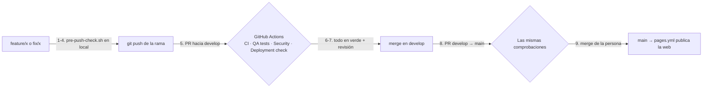

# Flujo de trabajo con Git

Cómo llega un cambio desde una rama de trabajo hasta la web publicada sin romper producción.
Las pruebas que se ejecutan en cada paso están en [QA_GUIDE.md](QA_GUIDE.md) y los workflows en
[CI_CD_ARCHITECTURE.md](CI_CD_ARCHITECTURE.md).

## Ramas

| Rama | Para qué | Quién escribe |
|---|---|---|
| `main` | Producción. **Hacer merge a `main` publica la web** (`pages.yml`). Siempre estable. | Solo pull requests desde `develop`, y el merge lo hace la persona |
| `develop` | Integración: cambios ya validados que esperan a publicarse juntos | Solo pull requests desde `feature/*`, `fix/*` o `test/*` |
| `feature/<descripcion>` | Funcionalidad nueva | Quien desarrolla (persona o Claude Code) |
| `fix/<descripcion>` | Corrección de un fallo | Quien desarrolla |
| `test/<descripcion>` | Experimentos y pruebas que quizá no se integren | Quien desarrolla |

Las ramas con otros prefijos que ya existen en el repositorio (`docs/`, `chore/`, `claude/`, `mejora/`…)
siguen siendo válidas (`tipo/descripcion`, CLAUDE.md): el script de QA las acepta con un aviso.

## El camino de un cambio



1. **Rama de trabajo** desde `develop` actualizada:
   ```bash
   git fetch origin
   git switch -c feature/mi-cambio origin/develop
   ```
2. **Pruebas locales** de lo que has tocado mientras trabajas (tabla de [TESTING.md](TESTING.md)) o,
   si trabaja Claude Code, el control de la tarea:
   ```bash
   bash scripts/qa/claude-task-check.sh "qué se pidió" --scope "frontend/js"
   ```
3. **Estado de Git** y 4. **batería completa** antes de subir (un solo comando):
   ```bash
   git status                       # todo en commits: el script falla si hay cambios sueltos
   bash scripts/qa/pre-push-check.sh
   ```
   Si lo instalas como hook (`bash scripts/qa/install-hooks.sh`), cada `git push` lo ejecuta y se
   cancela si algo falla. El hook también bloquea el push directo a `main`, `master` y `develop`.
5. **Subir la rama y abrir el PR hacia `develop`**:
   ```bash
   git push -u origin feature/mi-cambio
   gh pr create --base develop --fill   # o desde la web de GitHub
   ```
6. **GitHub Actions** ejecuta `CI`, `QA tests`, `Security` y `Deployment check`.
7. Si todas pasan y se ha revisado, se hace **merge en `develop`** (lo hace la persona).
8. **Publicar**: un PR independiente de `develop` a `main` con lo que se quiere sacar:
   ```bash
   gh pr create --base main --head develop --title "Publicar: <resumen>"
   ```
   Vuelven a ejecutarse todas las comprobaciones, ahora sobre lo integrado.
9. **Merge en `main`** (la persona): `pages.yml` publica la web. Render despliega el backend según
   su propia configuración (ver «Pendiente en GitHub y Render»).

## Reglas

- Nunca `git push` a `main` ni a `develop`: solo pull requests.
- Nada de comandos destructivos sobre ramas compartidas: ni `git push --force` a `main`/`develop`,
  ni `git reset --hard` sobre trabajo de otros, ni borrar ramas remotas ajenas. En tu propia rama,
  si hace falta reescribir, `git push --force-with-lease`.
- Un PR, un tema. Si aparece otra cosa, otra rama.
- Nunca borrar ni saltar una prueba para que pase el pipeline (el script y `QA tests` lo detectan:
  pruebas borradas, `skip`, `only`, `xfail` o cobertura rebajada). Un `skip` condicional legítimo
  lleva el comentario `qa-allow-skip: <motivo>` en la misma línea, a la vista en la revisión.
- Los JSON generados de `frontend/data/` se cambian con su script, no a mano (también se detecta).

## Conflictos

```bash
git fetch origin
git rebase origin/develop          # o git merge origin/develop si prefieres no reescribir
# resuelve los archivos que indique Git, después:
git add <archivos> && git rebase --continue
bash scripts/qa/pre-push-check.sh  # comprueba de nuevo (incluye la búsqueda de marcas <<<<<<<)
git push --force-with-lease        # solo en TU rama, nunca en develop ni main
```

## Transición desde el flujo anterior

Hasta ahora todos los PR iban directamente a `main`. Los PR abiertos que ya apuntan a `main` pueden
seguir así o cambiar su base a `develop` desde la web del PR («Edit» junto al título). Los nuevos van
a `develop`. Dependabot abre sus PR hacia `develop` (`.github/dependabot.yml`).

## Protección de `main` y `develop` (configuración manual)

Estas reglas no se pueden activar desde el código: las configura quien administra el repositorio en
GitHub. **Estado comprobado el 08/11/2026 con la API pública de GitHub: `main` no tiene protección
(`"protected": false`) ni rulesets.** Hasta que se configuren, las reglas de arriba dependen de la
disciplina de cada uno y del hook local.

Pasos (GitHub → *Settings* → *Rules* → *Rulesets* → *New branch ruleset*):

1. **Nombre**: `produccion`. **Enforcement status**: *Active*. **Target branches**: *Add target* →
   *Include by pattern* → `main`. (Repite después con otro ruleset `integracion` para `develop`.)
2. Marca:
   - **Restrict deletions** (prohibir borrar la rama).
   - **Block force pushes** (prohibir force push).
   - **Require a pull request before merging**, con **Require conversation resolution before merging**.
     En un repositorio de una sola persona deja *Required approvals* en 0: GitHub no deja aprobar tu
     propio PR y te bloquearías.
   - **Require status checks to pass**, con **Require branches to be up to date before merging**, y
     añade (aparecen en la lista cuando han corrido al menos una vez en un PR):
     `backend`, `e2e`, `webkit`, `cursos` (CI) · `Git (rama, cambios y conflictos)`,
     `Frontend (JS, HTML, CSS y Web Workers)`, `Backend, integración y seguridad (QA)`,
     `Informe de QA` (QA tests) · `Secretos, análisis estático y dependencias` (Security) ·
     `Artefacto de GitHub Pages`, `Imagen Docker del backend`, `Workflows y configuración de Render`
     (Deployment check).
3. Opcional: en *Bypass list* no añadas a nadie, para que la regla también te aplique a ti.
4. **Environment** `github-pages` (*Settings* → *Environments*): en *Deployment branches and tags*
   deja solo `main`, para que ningún otro workflow pueda publicar la web.

Comprobación posterior (sin credenciales):

```bash
curl -s https://api.github.com/repos/Marbi8891/python-learning-dashboard/branches/main | grep '"protected"'
# "protected": true  → la protección está activa
```

## Pendiente en GitHub y Render

- Crear las reglas de arriba (no se ha podido hacer desde el código).
- **Render**: si el servicio `pld-api` tiene *Auto-Deploy* activado, despliega el backend con cada
  push a la rama que tenga configurada, sin esperar a GitHub Actions. Comprueba en el panel de Render
  que la rama es `main` y, si quieres que espere a las comprobaciones, pon *Auto-Deploy* en
  «After CI checks pass» (*Settings* → *Build & Deploy*). No se ha podido verificar desde aquí.
- Code scanning de GitHub (CodeQL): gratis en repositorios públicos. Si se quiere, se activa en
  *Settings* → *Code security* → *CodeQL analysis* → *Default*. No se ha añadido un workflow propio
  para no chocar con la configuración por defecto.
