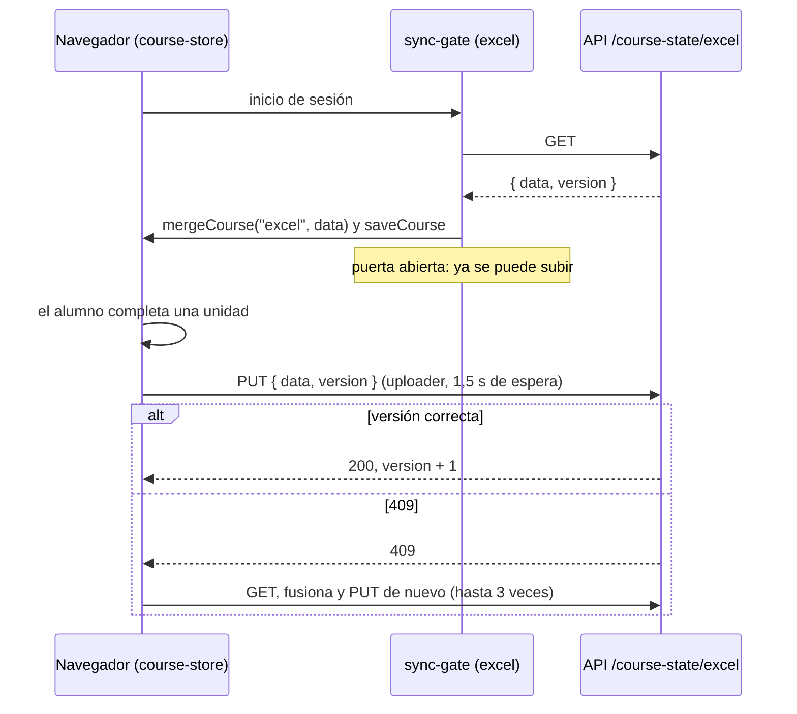

# Especificación de la API · Excel profesional

**Anexo 6 de la [especificación maestra](MASTER_SPECIFICATION.md)** · Versión 1.0 · 16/11/2026.

**Resumen:** Excel profesional **no añade ningún endpoint**. Usa los que ya existen para los cursos de DAW, con el id `excel` añadido a la lista permitida en el PR #159. Este anexo documenta el contrato tal como está en el código.

## 1. Endpoints que usa el curso

Prefijo: `/api/v1` (`API_V1_PREFIX`, `main.py:178`). El frontend escribe `/api/course-state/<id>` y **[H]** `frontend/js/api.js` lo convierte en `/api/v1/…` antes de llamar.

| Método y ruta | Uso | Estado |
|---|---|---|
| `GET /api/v1/course-state/excel` | Leer el documento de progreso de la cuenta | **[H]** acepta `excel` (PR #159, `test_course_catalog.py`) |
| `PUT /api/v1/course-state/excel` | Guardar con control de versión | **[H]** ídem |
| `GET /api/v1/users/me/export` | Exportar la cuenta (incluye `courses.excel`) | **[H]** comprobado en `test_course_catalog.py` |
| `POST /api/v1/users/me/delete` | Borrar la cuenta (borra todas sus filas de `course_states`) | **[H]** existente, sin cambios |

## 2. `GET /api/v1/course-state/{course}`

| Aspecto | Valor |
|---|---|
| Autenticación | `Authorization: Bearer <jwt>` o cookie `__Host-pld_session` con la cabecera `X-PLD-Session: cookie` |
| `course` | Uno de `COURSES` (`schemas.py:192`): `sql, js, java, entornos, marcas, programacion, excel, learn, game, planner` |
| 200 | `{ "data": { … }, "version": 3, "updated_at": "…" }` (`PcapStateOut`); si la cuenta aún no tiene documento, `state_documents.to_out(None)` devuelve un documento vacío con versión 0 |
| 401 | Sin sesión o token revocado (`token_version`) |
| 404 | `course` fuera de la lista |

## 3. `PUT /api/v1/course-state/{course}`

```json
{ "data": { "done": { "xl1-interfaz": "2026-11-16T09:10:00.000Z" } }, "version": 3 }
```

| Respuesta | Cuándo |
|---|---|
| 200 | Guardado; devuelve el documento con `version + 1` |
| 401 | Sin sesión |
| 404 | Curso desconocido |
| 409 | `version` no coincide con la del servidor (`UPDATE … WHERE version`); el cliente vuelve a leer, fusiona y reintenta hasta 3 veces (`doc-sync.js`) |
| 413 | Cuerpo mayor que el límite del middleware `BodySizeLimit` |
| 422 | `data` mayor que 200 000 bytes (validador de `PcapStateIn`) o con forma inválida |
| 429 | Límite de escritura del usuario (`WritingUser`) |

## 4. Flujo de sincronización



**[H]** Cada curso tiene su propia puerta (`sync-gate.js`): si `excel` falla al leer (red o 404), reintenta a los 2, 10, 30 y 60 s y no bloquea los demás cursos.

## 5. Cambios de la API por fase

| Fase | Cambio |
|---|---|
| P0 | **[H]** `"excel"` en `COURSES`; comentario de `course_state.py` |
| P1-P3 | Ninguno |
| P4 | Ninguno previsto. Una evaluación verificada (DP-10) necesitaría un endpoint nuevo como `verified_exams.py`; requiere autorización aparte |

## 6. Despliegue y orden

Al fusionar el PR #159 se publican a la vez GitHub Pages y, **[Hip]**, el backend en Render (depende de su despliegue automático; no comprobado). Si la web nueva llega antes que el backend, `GET /course-state/excel` da 404 durante unos minutos; la puerta de Excel reintenta y los demás cursos siguen sincronizando. Nada se pierde: el progreso de Excel está vacío hasta P2.
