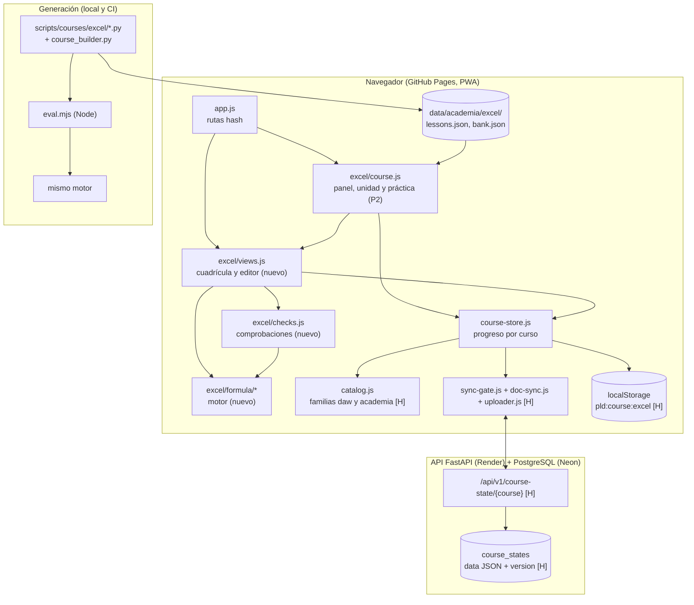
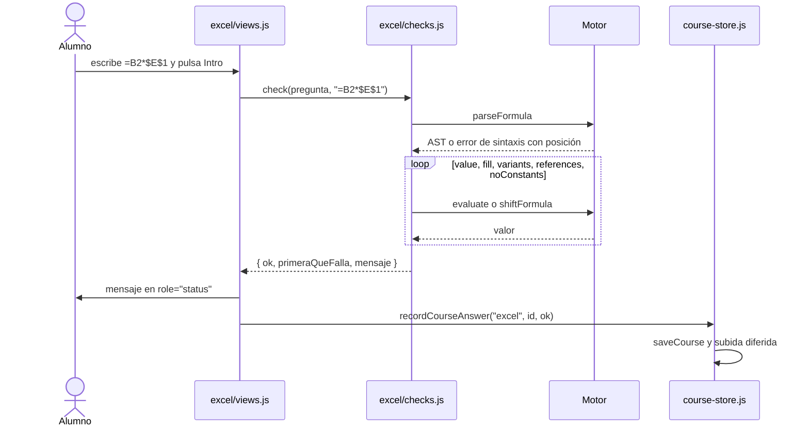

# Arquitectura · Excel profesional

**Anexo 2 de la [especificación maestra](MASTER_SPECIFICATION.md)** · Versión 1.1 · 17/11/2026 · Estado: P0, P1 y P2 implementadas. La v1.1 recoge DT-05 y DT-06 (especificación maestra §6): vista propia `excel/course.js` y datos en `data/academia/excel/`.
Base: `main` en `3b2dd8b` y rama `claude/project-thread-tr7z7w` en `ebda151` (PR #159). Todo lo marcado **[H]** está comprobado en el código de esa rama; lo demás es diseño.

## 1. Principios

1. **Reutilizar, no duplicar** (DA-03, DA-10): el curso usa el generador, las vistas, el almacén de progreso y la sincronización de los cursos de DAW.
2. **DAW no cambia** (RF-23): las fichas de DAW, sus JSON y sus vistas quedan idénticos.
3. **Sin dependencias, tablas ni frameworks nuevos** (RNF-01, RNF-02; prompt maestro: «no migres el frontend a otro framework»).
4. **Lo que es de Excel vive en `frontend/js/excel/`**. Desde P2 (DT-05), el curso tiene su propia vista, `excel/course.js`, y `daw.js` no cambia (R-05 evitado).

## 2. Vista general

## 3. Componentes: reutilizados y nuevos

| Componente | Archivo | Estado | Reutilizado o nuevo | Cambio que necesita |
|---|---|---|---|---|
| Catálogo por familias | `frontend/js/catalog.js` | **[H] P0** | Nuevo | — |
| Almacén de progreso | `frontend/js/course-store.js` | **[H] P0** | Reutilizado | Recorre `SYNCED_COURSES` (hecho) |
| Puerta de sincronización | `sync-gate.js` | **[H]** existente | Reutilizado | Ninguno |
| Guardado con versión y 409 | `doc-sync.js`, `uploader.js` | **[H]** existente | Reutilizado | Ninguno |
| Limpieza del progreso | `progress-guard.js` | **[H]** existente | Reutilizado | Añadir `rubrics` en P3 y `xlsx` en P4 |
| Dueño del progreso local | `local-owner.js` (AUTH-02) | **[H]** existente | Reutilizado | Ninguno |
| Vistas de curso | `excel/course.js` y `excel/progress.js` | **[H] P2** | Nuevo (DT-05); reutiliza el almacén, `lesson-progress.js`, el Markdown seguro, la 404 y los estilos de DAW | `daw.js` sin cambios |
| Rutas | `app.js` | **[H] P2** | Reutilizado | Zona `excel` con carga diferida; `#/academia/excel` y subrutas; alias `#/excel-academy` (DA-25); entrada en el menú (DA-23) |
| Motor de fórmulas | `excel/formula/*.js` | Diseño | Nuevo | P1 |
| Comprobaciones de ejercicios | `excel/checks.js` | Diseño | Nuevo | P1 |
| Cuadrícula y editor | `excel/views.js`, `css/excel.css` | Diseño | Nuevo | P1 (componentes), P2 (uso) |
| Generador | `course_builder.py` | **[H]** existente | Reutilizado | P1: `module` opcional, tipos nuevos, campos opcionales, llamada a `eval.mjs` |
| Contenido del curso | `scripts/courses/excel_course.py`, `excel/m01.py`, `excel/m02.py`, `excel/units.py` | **[H] P2** | Nuevo | JSON en `frontend/data/academia/excel/` (DT-06); ids en `academia.lock.json` |
| API de progreso | `routers/course_state.py` | **[H] P0** | Reutilizado | Solo `"excel"` en `COURSES` (hecho) |
| Precache | `precache.js` (generado) | **[H]** | Reutilizado | Regenerar en cada fase |
| Lector XLSX | `excel/xlsx/*` | En pausa (DA-11) | Nuevo | P4 con autorización |

## 4. Servicios y estado

| Capa | Qué guarda | Quién la escribe |
|---|---|---|
| Contenido | JSON generados (solo lectura en la web) | Generador |
| Estado del curso | Objeto en memoria de `course-store.js` por id | Vistas, a través de `recordCourseAnswer`, `markDone`… |
| Persistencia local | `pld:course:excel` | `saveCourse` |
| Persistencia en la cuenta | `course_states(user_id, "excel")` | `uploader.js` (PUT con versión) |
| Estado de la vista | Celda activa, fórmula escrita, pista mostrada | `excel/views.js`, no se persiste |

El motor y `checks.js` son **funciones puras**: reciben la pregunta y lo que escribió el alumno y devuelven el resultado de cada comprobación. No tocan el estado.

## 5. Flujo de un ejercicio de fórmula

## 6. Endpoints, persistencia y sincronización

Ver [API_SPECIFICATION.md](API_SPECIFICATION.md) y [DATA_MODEL.md](DATA_MODEL.md). Resumen: ningún endpoint nuevo; un documento JSON por curso; fusión en el cliente; control de concurrencia con `version` y 409.

## 7. Autenticación y autorización

**[H]** Sin cambios (DA-10). JWT por `Authorization: Bearer` o cookie `__Host-pld_session` con la cabecera `X-PLD-Session: cookie` (protección CSRF); revocación por `token_version`; límite de escritura `WritingUser`. Un usuario solo lee y escribe sus propias filas (`user.id` de la sesión). El anónimo no llama a la API. No hay roles nuevos.

## 8. Validación y errores

| Dónde | Qué se valida | Si falla |
|---|---|---|
| Generador (build y CI) | Esquema de unidades y preguntas; mínimos; respuestas calculadas con el motor; errores frecuentes que fallan | El script se para y CI falla (`--check`) |
| Motor | Sintaxis, límites, tipos | Error de sintaxis con posición o valor de error |
| Vista | Fórmula vacía o sin `=` | Mensaje de ayuda, no cuenta como intento |
| `progress-guard.js` | Tipos del progreso que llega de fuera | Descarta lo inválido |
| Backend | `course` en `COURSES`; tamaño ≤ 200 000 bytes; `version` | 404, 422, 409 |

## 9. Seguridad

Resumen; el detalle está en [SECURITY_AND_RISK_ASSESSMENT.md](SECURITY_AND_RISK_ASSESSMENT.md).

- Sin `eval` ni `Function`; la CSP actual (`script-src 'self'` más Google y el CDN de Pyodide) no se toca.
- Todo texto que venga del alumno o del JSON se pinta con `textContent` o con el escapado que ya usa `daw.js`, nunca con `innerHTML` sin escapar.
- La corrección es formativa: las soluciones están en el JSON público.

## 10. Rendimiento

| Aspecto | Decisión |
|---|---|
| Evaluación | Hilo principal; cuadrícula < 200 celdas; presupuesto de 100 000 pasos; < 50 ms p95 |
| Carga | El motor se importa solo en las rutas de Excel (`import()` dinámico), así la portada y DAW no lo descargan |
| Tamaño | Motor < 60 KB sin minificar; JSON del curso piloto **[Hip]** ~150-250 KB |
| Worker | Solo para el lector XLSX (P4) |

## 11. Accesibilidad

- Cuadrícula como `<table>` con `<th scope>` de filas y columnas y `<caption>`.
- Editor como `<input>` con `<label>`, ayuda en `aria-describedby` y resultado en `role="status"`.
- Todo con teclado: Tab al editor, Intro comprueba, Escape borra; foco visible.
- Ningún estado solo por color (correcto e incorrecto con texto e icono).
- axe con 0 infracciones en claro y oscuro (P-ACC-01).

## 12. PWA y dispositivos

- Los archivos nuevos entran en `precache.js` (regenerado con `scripts/web/build_precache.mjs`).
- Sin conexión: se estudia lo visitado; el progreso se sube al volver (uploader existente).
- Móvil: a 320 px la página no se desplaza en horizontal; la cuadrícula se desplaza dentro de su contenedor con `overflow-x: auto` y una pista visible.
- Navegadores: Chromium y WebKit (job de CI existente); Firefox **[Hip]** sin prueba automática.

## 13. Lo que no se toca

Autenticación, sincronización (lógica), base de datos y migraciones, `game.js` (XP y logros), el PCAP y su almacén, los certificados, la portada, el panel por módulo de DAW, `private.js`, la CSP y los workflows de despliegue.
