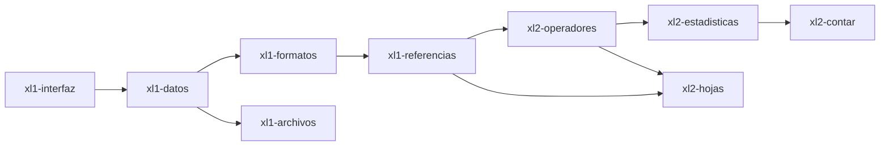

# Currículo del piloto: M01 y M02

**Anexo 7 de la [especificación maestra](MASTER_SPECIFICATION.md)** · Versión 1.0 · 16/11/2026 · Estado: **diseño; el contenido no está escrito ni autorizado** (fase P2, DP-04).
Fuente: doc original 07 §2-§4 y doc 06. Cambio principal respecto al original: **las correcciones «X» (práctica .xlsx) se sustituyen** por ejercicios de cuadrícula (`formula-result` y `formula`), porque el lector XLSX no se desarrolla (DA-11).

Las respuestas de los ejercicios de ejemplo de este anexo se han calculado a mano y con Python el 16/11/2026. El generador las volverá a calcular con el motor y se parará si alguna no cuadra.

## 1. Marco del piloto

| Rasgo | Valor |
|---|---|
| Versión de referencia | Excel de Microsoft 365 en español de España, escritorio |
| Horas estimadas | 18 (M01: 10, M02: 8). Dedicación prevista, no medida (DA-08) |
| Unidades | 9 |
| Ejercicios | 111 (mínimo exigido: 100) |
| Niveles pedagógicos | 1 reconocimiento · 2 aplicación · 3 resolución de problemas (4 y 5 empiezan en M15) |
| Datos | Empresas y personas ficticias. Ningún dato real |
| Funciones | Solo las 8 de la v1 del motor (SUMA, PROMEDIO, MIN, MAX, CONTAR, CONTARA, PRODUCTO, REDONDEAR). Ninguna necesita etiqueta de versión |
| Corrección | Formativa, en el navegador (DA-14) |

**Conocimientos previos del piloto:** usar un ordenador con ratón y teclado, abrir y guardar archivos, aritmética de 1.º de ESO (porcentajes, prioridad de operaciones). No hace falta haber usado Excel. Se recomienda tener Excel 365 o Excel para la web (gratuito con cuenta de Microsoft) para practicar fuera de PLD; el piloto no lo exige.

## 2. Plantilla de unidad

Cada unidad tiene, en este orden: objetivos · explicación · ejemplos resueltos · fórmulas paso a paso · ejercicio guiado · ejercicio autónomo · caso administrativo · test · criterios para superarla · errores frecuentes · resumen · fuentes.

**Mínimos que comprueba el generador:** 3 objetivos; 1 ejemplo calculado; 6 preguntas de test; 3 de resultado (en unidades con fórmulas); 2 de escritura de fórmula (en unidades de fórmulas); 3 errores frecuentes con su corrección; fuentes con fecha.

## 3. Dependencias

Las dependencias son **recomendaciones** que muestra la interfaz («Antes conviene hacer…»), no bloqueos: DAW tampoco bloquea unidades, y bloquear cambiaría el comportamiento compartido.

## 4. Tipos de ejercicio

| Clave | Tipo | Qué hace el alumno | Corrección |
|---|---|---|---|
| T | `choice` (existe) | Elige una opción | Índice correcto; explicación de cada distractor |
| R | `formula-result` (nuevo) | Ve datos y una fórmula, escribe o elige el resultado | Número con tolerancia (0,005 por defecto) o texto sin distinguir mayúsculas |
| F | `formula` (nuevo) | Escribe la fórmula en una celda | Comprobaciones `value`, `fill`, `variants`, `references`, `noConstants`, `functions` (doc original 06 §3.C) |

## 5. Criterios para superar una unidad

Una unidad está **superada** (RF-21) cuando:

1. El mini-test (T y R) tiene ≥ 80 % con el último intento.
2. Todos los ejercicios F marcados como obligatorios (`pass.required`) están superados.

«Completada» sigue siendo el botón de DAW, sin condiciones. El panel muestra las dos cosas por separado.

**Superar un módulo:** todas sus unidades superadas y, desde P3, el simulacro del módulo (RF-28) con ≥ 70 %.

---

## 6. M01 · Fundamentos de Excel (10 h)

**Objetivo del módulo:** moverse por un libro, introducir datos de cada tipo sabiendo cómo los interpreta Excel, distinguir formato de valor y escribir fórmulas que se copian bien.
**Competencias:** `manejo-libro`, `entrada-datos`, `formato`, `referencias`.
**Requiere:** nada.

### 6.1 `xl1-interfaz` · Interfaz, libros y hojas

| Apartado | Contenido |
|---|---|
| Horas · nivel | 1,5 h · 1 |
| Objetivos | Identificar la cinta, la barra de fórmulas y el cuadro de nombres. Distinguir libro, hoja, celda y rango. Nombrar una celda (`C4`) y un rango (`B2:D5`) y saber cuántas celdas tiene |
| Contenidos | Cinta y pestañas; barra de fórmulas (muestra la fórmula, la celda muestra el resultado); cuadro de nombres; celda activa; filas (números) y columnas (letras); rangos rectangulares; varias hojas en un libro |
| Caso | Gestoría Albaida (ficticia): ordenar el libro de clientes en hojas «Clientes», «Facturas» y «Notas» |
| Ejercicios | 8 T + 3 R de tipo número (sin fórmula). Total 11 |
| Ejemplo verificable | «¿Cuántas celdas tiene el rango B2:D5?» → **12** (3 columnas × 4 filas) |
| Errores frecuentes | Confundir la celda activa con el rango seleccionado · creer que la celda guarda lo que muestra · llamar «libro» a la hoja |
| Dependencias técnicas | Solo `choice` (existente) y `formula-result` con `input: "number"` sin fórmula |
| Aceptación | 11 ejercicios; el generador valida respuestas y explicaciones |

### 6.2 `xl1-datos` · Introducir datos

| Apartado | Contenido |
|---|---|
| Horas · nivel | 2 h · 1 |
| Objetivos | Introducir texto, número, fecha y hora. Reconocer un «número almacenado como texto» y sus efectos. Usar el autorrelleno y deshacer |
| Contenidos | Cómo decide Excel el tipo; alineación por defecto como pista; coma decimal en es-ES; fechas como número de serie (solo concepto); el triángulo verde; autorrelleno de series |
| Caso | Alta de 10 clientes de la gestoría con su fecha de alta y su cuota |
| Ejercicios | 6 T + 5 R. Total 11 |
| Ejemplo verificable 1 (R) | Cuadrícula `A2 = "120"` (texto), `A3 = 80`. `=SUMA(A2:A3)` → **80**: en un rango, SUMA ignora el texto |
| Ejemplo verificable 2 (R) | Misma cuadrícula. `=A2+A3` → **200**: el operador `+` convierte el texto numérico |
| Errores frecuentes | Escribir `1,200` creyendo que es mil doscientos (en es-ES la coma es decimal: queda 1,2) · números con espacios · fechas escritas como texto |
| Dependencias técnicas | Motor: SUMA, conversión de texto numérico en aritmética (MF-10, §5 del motor) |
| Aceptación | Los dos ejemplos en los casos de referencia del motor |

### 6.3 `xl1-formatos` · Formatos de número

| Apartado | Contenido |
|---|---|
| Horas · nivel | 2 h · 2 |
| Objetivos | Aplicar formatos general, número, moneda (€), contabilidad, porcentaje y fecha. Explicar que el formato cambia cómo se ve, no el valor. Predecir el resultado de una fórmula sobre una celda con formato |
| Contenidos | Formatos y su efecto; decimales mostrados frente a guardados; porcentaje = valor/100; formato personalizado básico |
| Caso | Tarifa de precios de un taller: precios con IVA mostrados con 2 decimales |
| Ejercicios | 6 T + 5 R. Total 11 |
| Ejemplo verificable 1 (R) | `B2 = 2,675` con formato moneda de 2 decimales (se ve «2,68 €»). `=B2*100` → **267,5** |
| Ejemplo verificable 2 (R) | `C1 = 0,21` con formato porcentaje (se ve «21 %»). `=100*C1` → **21** |
| Errores frecuentes | Creer que reducir decimales redondea el valor · escribir `21` en una celda con formato porcentaje y obtener 2 100 % · confundir moneda y contabilidad |
| Dependencias técnicas | El formato es un dato de presentación de la cuadrícula (`format` en la celda), que el motor ignora |
| Aceptación | La cuadrícula muestra el valor formateado y el motor usa el valor guardado (prueba unitaria de la vista) |

### 6.4 `xl1-referencias` · Referencias relativas, absolutas y mixtas

| Apartado | Contenido |
|---|---|
| Horas · nivel | 3 h · 2 |
| Objetivos | Explicar qué pasa con `A1`, `$A$1`, `A$1` y `$A1` al copiar. Elegir el tipo de referencia correcto. Usar F4 |
| Contenidos | Copiar y rellenar; desplazamiento relativo; fijar fila, columna o ambas; tasas en una celda de datos, nunca dentro de la fórmula |
| Caso | IVA de varias facturas con el tipo en una celda |
| Ejercicios | 6 T + 4 R + 5 F. Total 15. Obligatorios para superarla: `xl1-ref-07` y `xl1-ref-10` |
| Ejemplo verificable 1 (F, `xl1-ref-07`) | Cuadrícula `B2:B6 = 100, 250, 80, 40, 1000`, `E1 = 0,21`. «Escribe en D2 el IVA y que funcione al copiarla hasta D6». Solución `=B2*$E$1`. `value` 21; `fill` hasta D6 → **52,5 · 16,8 · 8,4 · 210**; `references` debe contener `B2` relativa y `$E$1` absoluta; `noConstants` |
| Error frecuente que el corrector rechaza | `=B2*E1`: al copiarla, E1 pasa a E2… vacías y el IVA sale 0 (falla `fill`) · `=B2*0,21`: falla `noConstants` |
| Ejemplo verificable 2 (F, `xl1-ref-10`) | Tabla de multiplicar: `A2:A4 = 1, 2, 3`, `B1:D1 = 1, 2, 3`. «Escribe en B2 una fórmula que, copiada hasta D4, dé la tabla». Solución `=$A2*B$1`; `fill` hasta D4 → filas **1 2 3 · 2 4 6 · 3 6 9** |
| Error frecuente que el corrector rechaza | `=A2*B1` (falla `fill`) · `=$A$2*$B$1` (falla `fill`) |
| Dependencias técnicas | Motor: MF-04 y MF-06 (`shiftFormula` en filas y columnas) |
| Aceptación | Los dos ejercicios pasan con la solución y fallan con cada error frecuente, en el generador y en la e2e (P-E2E-02) |

### 6.5 `xl1-archivos` · Guardar, exportar y compatibilidad

| Apartado | Contenido |
|---|---|
| Horas · nivel | 1,5 h · 1 |
| Objetivos | Elegir entre .xlsx, .xlsm, .csv y PDF. Abrir un CSV con separador `;` y tildes sin que se estropee. Saber que hay funciones que no existen en versiones antiguas |
| Contenidos | Formatos; CSV en es-ES (`;` y UTF-8); exportar a PDF; las etiquetas [2019+], [2021+] y [365] del curso; **.xlsm puede contener macros: no abrir los de origen desconocido** |
| Caso | Exportar el listado de clientes para otro programa |
| Ejercicios | 8 T. Total 8 |
| Errores frecuentes | Guardar como CSV y perder las fórmulas y el formato sin saberlo · abrir un CSV en UTF-8 como ANSI · habilitar macros por costumbre |
| Dependencias técnicas | Solo `choice` |
| Aceptación | 8 preguntas; aviso de seguridad de macros visible |

---

## 7. M02 · Fórmulas y funciones básicas (8 h)

**Objetivo del módulo:** construir fórmulas con operadores y prioridad correctos, resumir datos con las funciones básicas sabiendo cómo tratan vacíos y textos, y combinar datos de varias hojas.
**Competencias:** `calculo-basico`, `agregacion`, `multihoja`, `facturacion`.
**Requiere:** M01 (recomendado).

### 7.1 `xl2-operadores` · Fórmulas y operadores

| Apartado | Contenido |
|---|---|
| Horas · nivel | 2 h · 2 |
| Objetivos | Escribir fórmulas con `+ - * / ^ % &`. Aplicar la prioridad de Excel y los paréntesis. Explicar por qué `=-2^2` da 4 |
| Contenidos | `=` al principio; operadores; prioridad (negación, %, ^, * /, + -, &, comparaciones); concatenar texto y números |
| Caso | Línea de factura de Taller Montesol (ficticia): cantidad × precio con descuento |
| Ejercicios | 6 T + 6 R + 3 F. Total 15. Obligatorio: `xl2-op-12` |
| Ejemplos verificables (R) | `=-2^2` → **4** · `=2+3*4` → **14** · `=200*10%` → **20** · `="Total: "&2+3` → **«Total: 5»** |
| Ejemplo verificable (F, `xl2-op-12`) | `A2:A4 = 3, 10, 2` (cantidad), `B2:B4 = 12,5; 4; 99,9` (precio), `C2:C4 = 0,1; 0; 0,25` (descuento). «Importe en D2, copiable hasta D4». Solución `=A2*B2*(1-C2)`; `fill` → **33,75 · 40 · 149,85**; `variants` 2 |
| Error frecuente que el corrector rechaza | `=A2*B2*1-C2` → 37,4 (prioridad: resta el descuento al final) |
| Dependencias técnicas | Motor: MF-02, MF-03 |
| Aceptación | Los cuatro casos de precedencia están en las pruebas del motor |

### 7.2 `xl2-estadisticas` · SUMA, PROMEDIO, MIN y MAX

| Apartado | Contenido |
|---|---|
| Horas · nivel | 2 h · 2 |
| Objetivos | Usar SUMA, PROMEDIO, MIN y MAX con rangos. Predecir cómo tratan las celdas vacías y el texto. Elegir una función frente a sumar celda a celda |
| Contenidos | Sintaxis `NOMBRE(arg;arg)`; rangos; vacíos y textos ignorados; PROMEDIO de un rango con vacíos ≠ suma / número de filas |
| Caso | Ventas mensuales de una tienda (enero a junio) |
| Ejercicios | 6 T + 5 R + 3 F. Total 14. Obligatorio: `xl2-est-09` |
| Ejemplo verificable (R) | `B2:B6 = 1200; 950; "sin datos"; (vacía); 1850`. `=PROMEDIO(B2:B6)` → **1 333,33** (4 000 / 3: el texto y la vacía no cuentan) · `=SUMA(B2:B6)` → **4 000** · `=MIN(B2:B6)` → **950** · `=MAX(B2:B6)` → **1 850** |
| Ejemplo verificable (F, `xl2-est-09`) | `B2:B7 = 1200; 950; 1430; 1100; 1850; 1620`. «Total del semestre en B8». Solución `=SUMA(B2:B7)` → **8 150**; `functions.requires: ["SUM"]`; `variants` 2 |
| Error frecuente que el corrector rechaza | `=SUMA(B2:B6)` → 6 530 (deja fuera junio) · `=B2+B3+B4+B5+B6+B7` (falla `functions`: el ejercicio enseña SUMA) |
| Dependencias técnicas | Motor: SUMA, PROMEDIO, MIN, MAX |
| Aceptación | Casos de vacío y texto en las pruebas del motor |

### 7.3 `xl2-contar` · CONTAR, CONTARA, PRODUCTO y REDONDEAR

| Apartado | Contenido |
|---|---|
| Horas · nivel | 2 h · 2 |
| Objetivos | Distinguir CONTAR (números) de CONTARA (no vacías). Usar PRODUCTO. Redondear el valor con REDONDEAR frente a solo formatearlo |
| Contenidos | Contar números, contar no vacías; PRODUCTO de un rango; REDONDEAR con dígitos positivos, 0 y negativos; por qué el IVA se redondea por línea |
| Caso | Recuento de facturas y redondeo del IVA |
| Ejercicios | 6 T + 5 R + 3 F. Total 14. Obligatorio: `xl2-con-11` |
| Ejemplo verificable (R) | `A2 = "F-001"`, `A3 = 120`, `A4` vacía, `A5 = "pendiente"`, `A6 = 80`. `=CONTAR(A2:A6)` → **2** · `=CONTARA(A2:A6)` → **4** |
| Ejemplo verificable (R) | `A2 = 3`, `B2 = 12,5`, `C2 = 0,9`. `=PRODUCTO(A2:C2)` → **33,75** |
| Ejemplo verificable (F, `xl2-con-11`) | `B2:B4 = 19,99; 7,40; 133,33`, `E1 = 0,21`. «IVA redondeado a céntimos en C2, copiable». Solución `=REDONDEAR(B2*$E$1;2)`; `fill` → **4,20 · 1,55 · 28,00**; **`tolerance: 0,0001`** (con la tolerancia por defecto, 4,1979 pasaría por 4,20) |
| Error frecuente que el corrector rechaza | `=B2*$E$1` → 4,1979 (sin redondear) · `=REDONDEAR(B2*E1;2)` (falla `fill`) |
| Dependencias técnicas | Motor: CONTAR, CONTARA, PRODUCTO, REDONDEAR |
| Aceptación | El generador avisa si la tolerancia de un ejercicio de redondeo es mayor que media unidad del último decimal |

### 7.4 `xl2-hojas` · Referencias entre hojas

| Apartado | Contenido |
|---|---|
| Horas · nivel | 2 h · 3 |
| Objetivos | Escribir referencias a otra hoja (`Enero!B5`, `'Primer trimestre'!B5`). Construir un resumen de varias hojas. Saber que existen las referencias 3D aunque PLD no las corrija |
| Contenidos | `Hoja!Celda`; comillas simples si el nombre tiene espacios; resumen trimestral; `=SUMA(Enero:Marzo!B5)` se explica como información, y el motor responde «no soportado» si se escribe |
| Caso | Resumen trimestral de un taller con hojas Enero, Febrero y Marzo |
| Ejercicios | 6 T + 3 R + 3 F. Total 12. Obligatorio: `xl2-hoj-08` |
| Ejemplo verificable (F, `xl2-hoj-08`) | `Enero!B5 = 4200`, `Febrero!B5 = 3900`, `Marzo!B5 = 4650`. «En Resumen!B2, el total del trimestre». Solución `=Enero!B5+Febrero!B5+Marzo!B5` → **12 750**; también vale `=SUMA(Enero!B5;Febrero!B5;Marzo!B5)` |
| Error frecuente que el corrector rechaza | `=B5+B5+B5` → 0 (se refiere a Resumen!B5, vacía) |
| Ejemplo verificable (R) | `'Hoja 2'!A1 = 15`. `='Hoja 2'!A1*2` → **30** |
| Dependencias técnicas | Motor: MF-05 (hojas con y sin comillas); la cuadrícula muestra pestañas de hoja |
| Aceptación | Ejercicio con hoja entre comillas en las pruebas del motor y en la e2e |

---

## 8. Resumen de volumen

| Unidad | T | R | F | Total |
|---|---|---|---|---|
| xl1-interfaz | 8 | 3 | 0 | 11 |
| xl1-datos | 6 | 5 | 0 | 11 |
| xl1-formatos | 6 | 5 | 0 | 11 |
| xl1-referencias | 6 | 4 | 5 | 15 |
| xl1-archivos | 8 | 0 | 0 | 8 |
| xl2-operadores | 6 | 6 | 3 | 15 |
| xl2-estadisticas | 6 | 5 | 3 | 14 |
| xl2-contar | 6 | 5 | 3 | 14 |
| xl2-hojas | 6 | 3 | 3 | 12 |
| **Total** | **58** | **36** | **17** | **111** |

## 9. Evaluación del piloto (P3)

| Evaluación | Contenido | Aprobado |
|---|---|---|
| Simulacro M01 | 15 preguntas (10 T/R + 5 F) con datos distintos de los ejercicios, sin pistas | ≥ 70 % |
| Simulacro M02 | 15 preguntas (8 T/R + 7 F) | ≥ 70 % |
| Rúbrica `xl1-archivos-r1` | Autoevaluación: exportar un CSV y abrirlo bien en otro programa | Revisada (no puntúa) |

## 10. Criterios de aceptación del piloto (resumen)

- 9 unidades publicadas con los mínimos de §2; 111 ejercicios; cada F con al menos un error frecuente que el corrector rechaza.
- Todas las respuestas comprobadas por el motor en el generador (`--check` en CI).
- Los seis cursos de DAW sin un byte de diferencia en su JSON.
- Revisión del propietario: estudia las 9 unidades y registra como mucho 3 fallos del corrector, todos corregidos.
- Avisos de no afiliación y de corrección formativa visibles.

## 11. Fuentes previstas

Documentación de soporte de Microsoft en español para cada función (URL y fecha de consulta en `sources` de la unidad); comprobación con LibreOffice 24.2 para las 8 funciones; comprobación final con el Excel 365 del propietario (≥ 30 casos, MF-VAL-04). No se copia material de Microsoft ni de academias.
