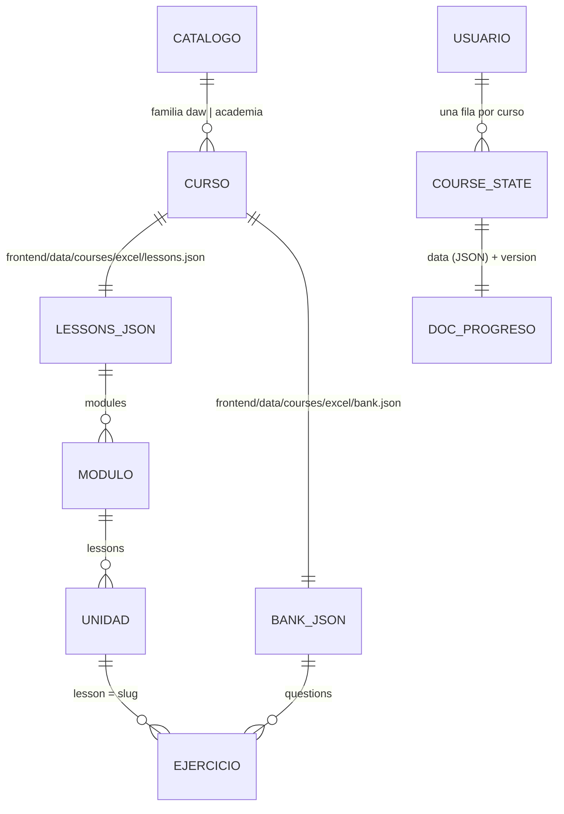

# Modelo de datos · Excel profesional

**Anexo 5 de la [especificación maestra](MASTER_SPECIFICATION.md)** · Versión 1.0 · 16/11/2026 · Estado: pendiente de revisión.
Fuente: doc original 03 §3, contrastado con el código de la rama `claude/project-thread-tr7z7w` (commit `ebda151`).

**Regla del proyecto:** sin tablas ni migraciones (DA-09). Todo el progreso vive en el JSON de `course_states.data` que ya existe para los cursos de DAW.

## 1. Mapa de entidades



| Entidad | Dónde vive | Estado |
|---|---|---|
| Catálogo | `frontend/js/catalog.js` (constante JS) | **[H] implementado** (PR #159) |
| Curso (contenido) | `frontend/data/courses/excel/{lessons,bank}.json`, generado | Diseñado (P2) |
| Progreso local | `localStorage["pld:course:excel"]` | **[H] implementado**: se crea y sincroniza (PR #159) |
| Progreso en la cuenta | Tabla `course_states` existente, `course = "excel"` | **[H] implementado**: la API lo acepta (PR #159) |

## 2. Catálogo (implementado)

```js
// frontend/js/catalog.js (rama del PR #159)
export const ACADEMY_COURSES = [{
  id: "excel", family: "academia", title: "Excel profesional",
  subtitle: "Excel de Microsoft 365 en español", lang: "excel",
  route: "#/academia/excel", hours: 120, status: "planned",
  structure: "Itinerario propio de la plataforma. No sigue ningún temario oficial ni de Microsoft.",
}];
export const COURSE_FAMILIES = Object.freeze({ daw: "Cursos de DAW", academia: "Academia" });
export const SYNCED_COURSES = [...DAW_COURSES, ...ACADEMY_COURSES];
```

| Campo | Tipo | Regla |
|---|---|---|
| `id` | texto | `^[a-z][a-z0-9-]{1,19}$`, único, presente en `COURSES` del backend (prueba de coherencia) |
| `family` | `"academia"` | Las fichas de DAW **no** llevan `family` (su familia se deduce de estar en `DAW_COURSES`) |
| `module` | — | Opcional: Excel no tiene módulo oficial |
| `status` | `"planned"` \| `"active"` | `planned` = sin contenido, no visible. Pasa a `active` en P2 |
| `route` | texto | `#/academia/excel` |

Las familias «certificación» e «independiente» del doc original 03 son solo diseño (DA-04).

## 3. Contenido generado (diseño, P2)

Lo genera `scripts/courses/excel/build.py` con `course_builder.py`. Nadie lo edita a mano (CLAUDE.md).

### 3.1 `lessons.json`

```json
{
  "course": "excel", "engine": "1.0.0",
  "modules": [
    { "id": "m01", "title": "Fundamentos de Excel", "hours": 10, "requires": [], "status": "active",
      "lessons": [
        { "slug": "xl1-referencias", "title": "Referencias relativas, absolutas y mixtas",
          "minutes": 180, "level": 2, "objectives": ["…"], "sections": [{ "kind": "explain", "html": "…" }],
          "mistakes": [{ "error": "=B2*E1", "fix": "…" }], "summary": "…", "sources": ["…"],
          "pass": { "testMin": 0.8, "required": ["xl1-ref-07"] } }
      ] },
    { "id": "m03", "title": "Formato profesional y gestión de libros", "hours": 4, "requires": ["m01"], "status": "planned", "lessons": [] }
  ]
}
```

`module` del curso (código oficial de DAW) pasa a ser opcional en `course_builder.py`. Los campos nuevos (`requires`, `status`, `minutes`, `level`, `pass`, `engine`) son opcionales para que los seis cursos de DAW generen **el mismo JSON byte a byte** (RF-23).

### 3.2 `bank.json → questions[]`

Tipos: `choice` (existe), `formula-result` y `formula` (nuevos, P1), `rubric` (nuevo, P3). Campos comunes nuevos y opcionales: `level` (1-5), `functions` (nombres canónicos), `competences`. El esquema completo de cada tipo está en [CURRICULUM_M1_M2.md](CURRICULUM_M1_M2.md) §4 y en el doc original 06 §3.

| Campo de `formula` | Tipo | Validación del generador |
|---|---|---|
| `grid` | `{ "A1": valor }` o `{ "Enero!B2": valor }` | ≤ 200 celdas; valores número, texto, booleano o `null` |
| `cell` | referencia | Dentro de la hoja, vacía en `grid` |
| `expect` | valor | Igual al resultado de `solution.formula` |
| `checks[]` | lista | Tipos conocidos; la solución las pasa todas |
| `mistakes[]` | lista | Cada `error` que es fórmula falla al menos una comprobación |
| `hints[]` | textos | ≥ 1 |

## 4. Documento de progreso `excel`

### 4.1 Campos existentes (los mismos que DAW, sin cambios)

| Campo | Contenido | Validación (`progress-guard.js`) | Fusión (`course-store.js`) |
|---|---|---|---|
| `answers` | `{ id: [bool…] }`, últimos 5 | Solo booleanos | Existente |
| `srs` | `{ id: { box, due, last } }` | `box` número, `due` día | Existente |
| `exams` | Simulacros | `date` ISO y números | Existente |
| `known`, `bestCombo`, `flags`, `plan` | Como DAW | Existente | Existente |
| `done` | `{ slug: ISO }` | `cleanDone` | Existente |
| `lastLesson` | `{ slug, at }` | `cleanLastLesson` | Existente |

**[H]** Comprobado en la e2e de PR #159: `done` de Excel se fusiona en los dos sentidos al iniciar sesión.

### 4.2 Campos propuestos (no implementados)

| Campo | Fase | Validación | Fusión |
|---|---|---|---|
| `rubrics[id]` = `{ at, items: [bool…] }` | P3 | id `^[a-z0-9][a-z0-9-]{0,79}$`; `at` ISO; ≤ 30 ítems | Gana la más reciente por `at` |
| `xlsx[id]` = `{ best, passedAt, tries }` | P4 (con el lector) | `best` 0-1; `tries` 0-10 000 | `best` máximo, `passedAt` la más antigua, `tries` máximo |
| Máximo por mapa | — | ≤ 500 entradas | Se recortan las más antiguas |

**[H] Hallazgo:** `cleanProgress` deja pasar sin tocar los campos que no conoce. Cuando lleguen `rubrics` o `xlsx`, hay que añadir su limpieza a `progress-guard.js` en la misma fase (P-SEG-04), porque si no, un `localStorage` manipulado podría llegar a la vista.

**No se guarda:** el texto de las fórmulas del alumno, tiempos reales ni datos personales.

### 4.3 Tamaño

| Límite | Valor | Fuente |
|---|---|---|
| Máximo del backend | 200 000 bytes (`MAX_PCAP_STATE_BYTES`, `schemas.py:184`) | **[H]** |
| Objetivo del curso completo | ≤ 60 KB (RNF-06) | **[Hip]** estimado con ~1 300 preguntas × 5 intentos |

## 5. Claves del navegador

| Clave | Quién | Al cerrar sesión |
|---|---|---|
| `pld:course:excel` | `course-store.js` | Se borra con el resto de `pld:*` (`store.js`) y se guarda en el apartado de la cuenta saliente (`local-owner.js`, AUTH-02) |

No hay claves nuevas para Excel aparte de esta.

## 6. Versionado y migraciones

- **Base de datos:** ninguna migración. `course_states` ya tiene `version` para el control de concurrencia (409).
- **Documento:** los campos nuevos son aditivos; una versión antigua de la web conserva los campos que no conoce, así que no los borra.
- **Contenido:** cambiar el texto de una pregunta mantiene su id (`lock_ids.py`); borrar una pregunta deja su historial huérfano, que no cuenta en los indicadores.
