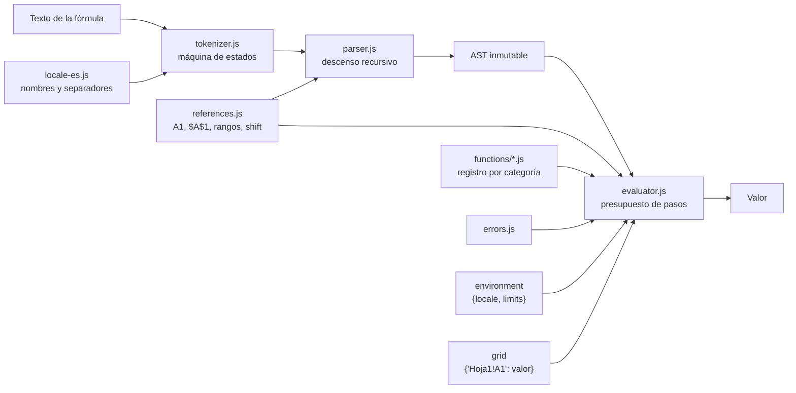

# Especificación del motor de fórmulas

**Anexo 4 de la [especificación maestra](MASTER_SPECIFICATION.md)** · Versión 1.0 · 16/11/2026 · Estado: **diseño aprobado; implementación de P1 autorizada el 17/11/2026** (DA-18).
Fuente: doc original 04, recortado al alcance aprobado (DA-06) y con la recalculación aclarada. **Nada de este anexo está implementado** en el repositorio: no existe `frontend/js/excel/`.

## 1. Objetivo y principios

El motor evalúa fórmulas de Excel en español sobre una cuadrícula pequeña de datos de ejercicio, en el navegador y en Node 22 (generador y pruebas), con el mismo código.

| Principio | Consecuencia |
|---|---|
| Motor propio, sin dependencias | **[H]** SheetJS CE y ExcelJS no calculan; Formula.js no tiene BUSCARX, FILTRAR ni LET; HyperFormula es GPL-3.0. Probado el 15/11 |
| Sin `eval`, `Function` ni código generado | Interpretación de un AST; prueba que lee el código fuente (MF-SEG-01) |
| Sin expresiones regulares como mecanismo principal | El tokenizer es una máquina de estados carácter a carácter; se admiten comprobaciones puntuales de un carácter |
| Puro | No lee el reloj, el DOM ni la red. Todo entra por `environment` |
| Subconjunto cerrado | Lo que no está soportado devuelve un error «no soportado», nunca un resultado inventado |
| Diferencias declaradas | Cada diferencia conocida con Excel se documenta (§9) y el generador impide ejercicios que dependan de ella |

## 2. Clasificación de las capacidades

| Clase | Significado |
|---|---|
| **Obligatoria v1** | Entra en P1 y la usan M01-M02 |
| **Prevista** | Especificada aquí; se implementa en P4 con su módulo (M04-M09). En v1 está en el registro con estado `planned` |
| **Futura** | Se diseñará cuando haga falta; no se especifica en detalle |
| **Descartada** | No se hará; si aparece, error «no soportado» |

| Capacidad | Clase | Requisito |
|---|---|---|
| Números con coma decimal, textos con `""`, `VERDADERO`/`FALSO`, errores literales | Obligatoria v1 | MF-01 |
| Operadores `+ - * / ^ % &` y comparaciones `= <> < > <= >=`, menos y más unarios | Obligatoria v1 | MF-02 |
| Precedencia de Excel, con `-2^2 = 4` | Obligatoria v1 | MF-03 |
| Referencias `A1`, `$A$1`, `A$1`, `$A1` y rangos rectangulares `A1:B5` | Obligatoria v1 | MF-04 |
| Referencias a otra hoja del mismo libro: `Enero!B2`, `'Hoja 2'!A1:A3` | Obligatoria v1 (la usa `xl2-hojas`) | MF-05 |
| Copia de fórmulas (`shiftFormula`) que respeta `$` y da `#¡REF!` al salir de la hoja | Obligatoria v1 | MF-06 |
| Errores como valores y su propagación | Obligatoria v1 | MF-07 |
| Límites de ejecución (§7) | Obligatoria v1 | MF-08 |
| Registro de funciones con estado `implemented` o `planned` | Obligatoria v1 | MF-09 |
| 8 funciones: SUMA, PROMEDIO, MIN, MAX, CONTAR, CONTARA, PRODUCTO, REDONDEAR | Obligatoria v1 | MF-10 |
| Nombres en español (es-ES) con `;` como separador | Obligatoria v1 | MF-11 |
| Detección de ciclos | Obligatoria v1 | MF-12 |
| Las otras 37 funciones de la lista de 45 (§6) | Prevista | MF-20 |
| Lógica perezosa de SI y SI.CONJUNTO, captura de SI.ERROR | Prevista (M04) | MF-21 |
| Criterios de SUMAR.SI y familia (`">100"`, comodines, `~`) | Prevista (M05) | MF-22 |
| Matrices dinámicas y desbordamiento (FILTRAR, ORDENAR, UNICOS) | Prevista (M09) | MF-23 |
| Fechas como número de serie (sistema 1900, desde el 01/03/1900) | Prevista (M07) | MF-24 |
| Nombres en inglés y conversión `toEnglish` / `toSpanish` (para leer .xlsx) | Prevista (con el lector, P4) | MF-25 |
| Grafo de dependencias y recálculo de un libro | Futura | MF-30 |
| PAGO, VA, VF, TASA, SLN, TEXTO, LET, DIVIDIRTEXTO, HOY | Futura (M16 y otros) | MF-31 |
| Nombres definidos y referencias estructuradas (`TFacturas[Total]`) | Futura (M11, M14) | MF-32 |
| Referencias 3D, externas, filas o columnas completas (`A:A`), intersección, unión, `{…}`, `@` | Descartada en v1 | — |
| Sistema de fechas 1904 y el 29/02/1900 ficticio | Descartada | — |
| Funciones volátiles (AHORA, ALEATORIO) | Descartada (los ejercicios usan fechas fijas) | — |

## 3. Arquitectura modular



| Archivo | Responsabilidad |
|---|---|
| `frontend/js/excel/formula/index.js` | API pública (§8) |
| `tokenizer.js` | Tokens: número, texto, booleano, error, referencia, hoja, nombre de función, operador, separador, paréntesis |
| `parser.js` | Gramática de §4.2; errores de sintaxis con posición |
| `ast.js` | Nodos `Number`, `Text`, `Bool`, `Error`, `Ref`, `Range`, `Unary`, `Binary`, `Percent`, `Call`, congelados |
| `evaluator.js` | Interpreta el AST con presupuesto de pasos, profundidad y pila de celdas para los ciclos |
| `references.js` | Analizar y escribir referencias; desplazar al copiar |
| `errors.js` | Valores de error y sus nombres en español e inglés |
| `functions/registry.js` | Mapa nombre canónico inglés → `{ status, minArgs, maxArgs, impl, since }` |
| `functions/math.js`, `functions/stats.js` | Las 8 funciones de v1 |
| `locale-es.js` | Nombres en español ↔ canónicos; `;` y `,` decimal |

## 4. Sintaxis

### 4.1 Léxico

| Elemento | Forma | Ejemplos |
|---|---|---|
| Número | Dígitos con `,` decimal opcional; exponente `E` | `3`, `0,21`, `1,5E3` |
| Texto | Entre comillas dobles; `""` es una comilla | `"Ana"`, `"dijo ""sí"""` |
| Booleano | `VERDADERO`, `FALSO` (sin distinguir mayúsculas) | |
| Error literal | `#¡DIV/0!`, `#N/D`, `#¡VALOR!`, `#¡REF!`, `#¿NOMBRE?`, `#¡NUM!` | |
| Referencia | Columna A-XFD + fila 1-1 048 576, con `$` opcionales | `B2`, `$E$1`, `A$1`, `$A1` |
| Hoja | Nombre sin espacios seguido de `!`, o entre comillas simples con `''` como comilla | `Enero!`, `'Hoja 2'!` |
| Función | Letras, dígitos y `.` (los nombres en español tienen punto), seguido de `(` | `REDONDEAR(`, `SUMAR.SI(` |
| Separador | `;` (es) | |

### 4.2 Gramática (de menor a mayor precedencia)

```
formula   := "="? expr
expr      := compare
compare   := concat (("=" | "<>" | "<" | ">" | "<=" | ">=") concat)*
concat    := additive ("&" additive)*
additive  := mult (("+" | "-") mult)*
mult      := power (("*" | "/") power)*
power     := percent ("^" percent)*
percent   := unary "%"*
unary     := ("-" | "+")* primary
primary   := number | text | bool | error | call | reference | "(" expr ")"
call      := NAME "(" (arg (";" arg)*)? ")"
arg       := expr | (vacío)
reference := (sheet "!")? cell (":" cell)?
```

Casos obligatorios de precedencia: `=-2^2` → 4; `=2+3*4` → 14; `=2^3^2` → 64 (Excel asocia la potencia por la izquierda); `="a"&1+1` → `"a2"`; `=10%` → 0,1; `=1=1` → VERDADERO.

## 5. Tipos, conversiones y errores

Valores: número (doble precisión), texto, booleano, error, vacío y rango (solo como argumento en v1).

| Operación | Regla v1 |
|---|---|
| Aritmética | Texto numérico en español (`"3,5"`) → número; otro texto → `#¡VALOR!`; VERDADERO → 1, FALSO → 0; vacío → 0 |
| `&` | Número → texto con coma decimal sin formato; booleano → `VERDADERO`/`FALSO`; vacío → `""` |
| Comparación | Texto sin distinguir mayúsculas; entre tipos distintos número < texto < booleano; vacío vale 0 o `""` según el otro lado |
| Agregación (SUMA, PROMEDIO, MIN, MAX, PRODUCTO, CONTAR) | En referencias, texto y booleanos se ignoran; escritos directamente, se convierten (`=SUMA("3";VERDADERO)` → 4) |
| CONTARA | Cuenta las celdas no vacías, incluidos textos, booleanos y errores |
| REDONDEAR | Redondeo «mitad lejos de cero», con corrección de la representación binaria (`=REDONDEAR(2,675;2)` → 2,68) |
| Un rango donde se espera un valor | `#¡VALOR!` en v1 (sin intersección implícita) |
| Comparación numérica | Los dos números se comparan redondeados a 15 cifras significativas, como hace Excel, para que `=0,1+0,2=0,3` dé VERDADERO |

| Error | Cuándo lo da el motor v1 |
|---|---|
| `#¡DIV/0!` | División por 0; PROMEDIO sin números |
| `#¡VALOR!` | Tipo incorrecto; rango donde se espera un valor |
| `#¡REF!` | Referencia que sale de la hoja al copiar; hoja que no existe en la cuadrícula |
| `#¿NOMBRE?` | Función desconocida. Si está en el registro como `planned`: `#¿NOMBRE?` con el mensaje «esta función todavía no está disponible en PLD» |
| `#¡NUM!` | Resultado infinito o no numérico |
| `#N/D` | Solo como literal en v1 (las búsquedas son previstas) |
| ciclo | La fórmula se refiere, directa o indirectamente, a la celda donde se escribe. Error propio del motor: «referencia circular» |
| no soportado | Construcción descartada (§2). Error propio con el motivo |

Propagación: un error en un argumento evaluado se devuelve tal cual. En v1 no hay funciones que capturen errores.

## 6. Funciones

### 6.1 Obligatorias v1 (8)

| Español | Canónico | Firma | Notas |
|---|---|---|---|
| SUMA | SUM | 1-64 argumentos | Vacío → 0 |
| PROMEDIO | AVERAGE | 1-64 | Sin números → `#¡DIV/0!` |
| MIN | MIN | 1-64 | Sin números → 0 (como Excel) |
| MAX | MAX | 1-64 | Sin números → 0 |
| CONTAR | COUNT | 1-64 | Solo números (y fechas, que son números) |
| CONTARA | COUNTA | 1-64 | No vacías |
| PRODUCTO | PRODUCT | 1-64 | Sin números → 0 (como Excel) |
| REDONDEAR | ROUND | 2 | Dígitos negativos redondean a decenas, centenas… |

Cada una con al menos 6 casos: normal, límite, inválido, anidado, error propagado y celda vacía.

### 6.2 Previstas (37, estado `planned`)

Matemáticas: REDONDEAR.MAS, ENTERO, RESIDUO. Lógicas: SI, Y, O, NO, SI.CONJUNTO **[2019+]**, SI.ERROR. Condicionales: SUMAR.SI, SUMAR.SI.CONJUNTO, CONTAR.SI, CONTAR.SI.CONJUNTO, PROMEDIO.SI, MAX.SI.CONJUNTO **[2019+]**, MIN.SI.CONJUNTO **[2019+]**. Texto: CONCAT **[2019+]**, IZQUIERDA, DERECHA, EXTRAE, LARGO, ESPACIOS, MAYUSC, HALLAR. Fecha: FECHA, AÑO, MES, DIA, FIN.MES, DIAS.LAB. Búsqueda: BUSCARV, INDICE, COINCIDIR, BUSCARX **[2021+]**. Dinámicas **[2021+]**: FILTRAR, ORDENAR, UNICOS.

Su semántica detallada está en el doc original 04 §6.3-§6.8 y se revisará al empezar su módulo. **[H]** LibreOffice 24.2 no calcula BUSCARX, UNICOS, ORDENAR ni FILTRAR, así que su contraste necesitará otra versión o el Excel 365 del propietario (R-09).

## 7. Dependencias, recálculo y ciclos

**Modelo v1 (propuesta, decisión pendiente DP-14):** el motor evalúa **una fórmula sobre una cuadrícula de datos estáticos**. Las celdas de datos del ejercicio son valores, no fórmulas. No hay grafo de dependencias ni recálculo encadenado.

| Situación | Comportamiento v1 |
|---|---|
| El alumno cambia la fórmula | Se vuelve a evaluar entera (la cuadrícula tiene < 200 celdas) |
| Copia hacia abajo (`fill`) | Se desplaza la fórmula y se evalúa cada celda destino por separado; las celdas ya rellenadas no se leen entre sí |
| Variantes de datos (`variants`) | Se generan cuadrículas nuevas con semilla y se evalúan la fórmula del alumno y la solución sobre cada una |
| Una celda de la cuadrícula contiene una fórmula (solo en casos de autor, p. ej. `xl2-hojas`) | Se evalúa a demanda con memoria por evaluación; la pila de celdas en curso detecta ciclos |
| La fórmula del alumno se refiere a su propia celda | Error de ciclo |

**Futuro (MF-30):** un grafo de dependencias con orden topológico hará falta para hojas con varias fórmulas encadenadas (proyectos, M15+). No entra en P1.

## 8. API

```js
import { parseFormula, evaluate, shiftFormula, functionStatus } from "./excel/formula/index.js";

const ast = parseFormula("=SUMA(B2:B4)*$E$1", { locale: "es" });   // o lanza FormulaSyntaxError { position, message }
const value = evaluate(ast, { grid, sheet: "Hoja1", at: "D2", environment });  // { type: "number", value: 165 }
const below = shiftFormula(ast, { rows: 1, cols: 0 });               // copia hacia abajo; devuelve un AST nuevo
functionStatus("BUSCARX");                                          // "planned"
```

`grid` es un objeto plano `{ "Hoja1!A1": valor }` o una función de lectura; `environment = { locale: "es", limits }`. El motor no conoce el DOM. `toEnglish` y `toSpanish` son previstas (MF-25).

## 9. Diferencias declaradas con Excel (v1)

| Caso | Excel | Motor v1 |
|---|---|---|
| Anidamiento | 64 niveles | 32 |
| Longitud de fórmula | 8 192 caracteres | 2 000 |
| Rango donde se espera un valor | Intersección implícita | `#¡VALOR!` |
| Referencia circular | Aviso y 0 | Error «referencia circular» |
| Representación de 15 dígitos | Exacta en todos los casos | Doble precisión con tolerancia |

Las del doc original 04 para funciones previstas (SUMAR.SI con rangos de distinto tamaño, criterios numéricos sobre texto numérico, INDICE con fila o columna 0) se mantienen y se revisarán en P4.

## 10. Validación

| Id | Prueba | Umbral |
|---|---|---|
| MF-VAL-01 | Unitarias de tokenizer, parser, referencias, copia, errores, límites y funciones | ≥ 150 casos de referencia del piloto, 100 % verde |
| MF-VAL-02 | Mismos casos en Node y en el navegador | 0 diferencias |
| MF-VAL-03 | Contraste con LibreOffice 24.2 (local, `scripts/excel/oracle_libreoffice.py`, opcional) | Las 8 funciones de v1 coinciden |
| MF-VAL-04 | Contraste con el Excel 365 del propietario | ≥ 30 casos, 0 diferencias no declaradas (P3) |
| MF-SEG-01 | El código no contiene `eval(`, `new Function`, `Function(` ni `setTimeout("` | Prueba que lee los archivos fuente |

Cada caso de referencia guarda su fuente: «LibreOffice 24.2, fecha», «Excel 365 del propietario, fecha» o «regla de la documentación de Microsoft, URL». No hay casos copiados de la salida del propio motor.

## 11. Límites de ejecución y rendimiento

| Límite | Valor | Al superarlo |
|---|---|---|
| Longitud | 2 000 caracteres | Error de sintaxis «demasiado larga» |
| Tokens | 1 000 | Ídem |
| Profundidad del AST | 32 | «demasiado anidada» |
| Argumentos por función | 64 | Error de sintaxis |
| Celdas de un rango | 10 000 | «rango demasiado grande» |
| Pasos de evaluación | 100 000 por fórmula | «demasiado costosa» |
| Celdas evaluadas por ejercicio (con la copia) | 500 | Ídem |

Rendimiento: comprobar un ejercicio (incluida la copia y 2 variantes) < 50 ms p95 (RNF-04); se evalúa en el hilo principal porque la cuadrícula es pequeña y el presupuesto de pasos corta los casos costosos.

## 12. Persistencia y compatibilidad futura

- El motor no guarda nada. El progreso solo registra acierto o fallo por pregunta (`answers`), como en DAW. **No se guarda el texto de la fórmula del alumno** en el piloto (menos datos personales y documento más pequeño).
- El registro con `status` permite añadir funciones sin cambiar los ejercicios ya publicados.
- El AST canónico (nombres ingleses) permite añadir otros idiomas y leer .xlsx (que guardan fórmulas en inglés con `,` y prefijos `_xlfn.`) sin cambiar el evaluador.
- Una versión del motor (`ENGINE_VERSION`) se escribe en el JSON del curso generado, para saber con qué motor se comprobaron las respuestas.
