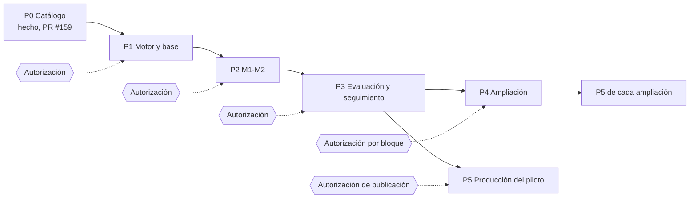

# Hoja de ruta · Excel profesional

**Anexo 10 de la [especificación maestra](MASTER_SPECIFICATION.md)** · Versión 1.0 · 16/11/2026 · Estado: **propuesta**. Las horas son estimaciones **[Hip]**, no compromisos.

## 1. Numeración de fases: equivalencias

Hay dos numeraciones en los documentos. Este anexo adopta la del prompt de consolidación (P0-P5), porque separa el motor del contenido y deja la publicación al final. El propietario la aprobó el 17/11/2026 (DA-21).

| Esta hoja de ruta | Doc original 08 | Autorización del 16/11 (mañana) |
|---|---|---|
| **P0** Catálogo | Fase 1 (P0) | Autorizada y **hecha** (PR #159) |
| **P1** Motor y base funcional | Fase 2 (P1a) | Formaba parte de «P1 = motor + M1-M2»; espera autorización tras revisar P0 |
| **P2** Contenido M1-M2 | Fase 4 (P1b) | Ídem |
| **P3** Evaluación y seguimiento | Fase 5 (validación) y parte de la 4 | Sin autorizar |
| **P4** Ampliación y funciones profesionales | Fase 3 (lector XLSX, en pausa) y «fuera del plan» (M03+) | **No autorizada**. Lo que la autorización llamó «P2» (no avanzar sin nueva autorización) queda aquí |
| **P5** Estabilización y producción | No existía | Sin autorizar |

**Por qué cambia el orden respecto al prompt:** ninguno. Se mantiene P0 → P5. Lo único que se mueve es el lector XLSX, que pasa a P4 (DA-11), y la validación del propietario, que entra en P3.

Cada flecha exige que la fase anterior cumpla sus criterios de aceptación **y** una autorización expresa del propietario.

## 2. Fases

### P0 · Catálogo por familias (hecho)

| Apartado | Detalle |
|---|---|
| Objetivo | Registrar `excel` en la familia academia con documento de progreso y sincronización, sin cambiar DAW ni nada visible |
| Alcance | `catalog.js`, `course-store.js`, `schemas.py`, docstring de `course_state.py`, `precache.js`, pruebas, DEC-018, CHANGELOG, dos docs de temario |
| Estado | **[H]** PR #159 en borrador; CI 7/7 verde; revisión entregada (`P0_REVISION.md`) |
| Aceptación | Cumplida: `DAW_COURSES` idéntico, baterías verdes, `GET/PUT excel` con versión y 409, nada visible |
| Para avanzar | Autorización de P1. Fusionar el PR #159 es independiente (DP-05) |

### P1 · Motor y base funcional

| Apartado | Detalle |
|---|---|
| Objetivo | Motor de fórmulas v1 y piezas comunes listas para escribir contenido, sin nada visible en la web |
| Alcance | Motor ([FORMULA_ENGINE_SPEC.md](FORMULA_ENGINE_SPEC.md), capacidades «obligatoria v1»); `excel/checks.js`; componentes de cuadrícula y editor en `excel/views.js` y `excel.css`; `course_builder.py` con `module` opcional y tipos `formula-result` y `formula`; `scripts/courses/excel/eval.mjs`; casos de referencia |
| Archivos | `frontend/js/excel/formula/*`, `frontend/js/excel/checks.js`, `frontend/js/excel/views.js`, `frontend/css/excel.css`, `scripts/courses/course_builder.py`, `scripts/courses/excel/eval.mjs`, `tests/unit/excel-*.test.mjs`, `tests/fixtures/excel/reference-cases.json`, `e2e/excel.spec.js`, `precache.js`, `docs/DECISIONS.md` |
| Dependencias | P0 (fusionado o como base de la rama) |
| Riesgos | R-01 (diferencias con Excel), R-21 (tolerancia), tocar `course_builder.py` (REG-04) |
| Pruebas | P-UNI-01 a 07, P-INT-01, 02, 06, P-SEG-01, 03, P-REN-01, 02, más REG-01 a 06 |
| Aceptación | ≥ 150 casos de referencia en verde en Node y navegador; las 37 funciones previstas responden «todavía no disponible»; los seis cursos de DAW con el mismo JSON; ninguna ruta nueva visible; CI verde |
| Para avanzar | Revisión del propietario y autorización de P2 |
| Esfuerzo | **[Hip]** 20-30 h |

### P2 · Contenido M1-M2

| Apartado | Detalle |
|---|---|
| Objetivo | Las 9 unidades y 111 ejercicios de [CURRICULUM_M1_M2.md](CURRICULUM_M1_M2.md), con la ruta `#/academia/excel` |
| Alcance | `scripts/courses/excel_course.py`, `excel/m01.py`, `excel/m02.py`; `frontend/data/academia/excel/*` (generado, DT-06); vista propia `excel/course.js` en lugar de ampliar `daw.js` (DT-05); rutas y menú en `app.js` e `index.html`; avisos; indicadores básicos; `catalog.js` pasa `excel` a `active`; paso de CI `excel_course.py --check` |
| Dependencias | P1 |
| Riesgos | R-05 (`daw.js`), R-15 (marca), R-17 (publicación) |
| Pruebas | P-INT-07, P-E2E-01 a 09, P-SEG-02, P-ACC-01 a 03, REG-01 a 07 |
| Aceptación | 9 unidades con sus mínimos; e2e y axe verdes; DAW sin cambios; CI verde |
| Para avanzar | El propietario estudia las unidades (puede hacerlo en local o en una vista previa) y autoriza P3 |
| Esfuerzo | **[Hip]** 25-40 h (la mitad, contenido) |
| Publicación | Fusionar P2 publica el curso (R-17). Decidido (DA-23): al fusionar, el curso es visible para todos (`status: "active"`, menú y portada) |
| Estado | **[H]** Implementada el 17/11/2026 (DT-05: vista propia `excel/course.js`; DT-06: datos en `data/academia/excel/`). La fusión la decide el propietario |

### P3 · Evaluación y seguimiento

| Apartado | Detalle |
|---|---|
| Objetivo | Medir y validar el piloto |
| Alcance | Panel del curso con los indicadores; «superada» frente a «completada»; simulacros de M01 y M02 (RF-28); rúbrica de `xl1-archivos`; `rubrics` en `progress-guard.js` y `mergeCourse`; contraste con el Excel 365 del propietario; informe del piloto |
| Dependencias | P2 |
| Riesgos | R-11, R-12, R-20 |
| Pruebas | P-UNI-08, 10, P-SEG-04, P-REN-03, P-EXT-01 |
| Aceptación | Criterios cuantificables de [TESTING_STRATEGY.md](TESTING_STRATEGY.md) §5 |
| Para avanzar | Informe del piloto y decisión del propietario sobre P4 y P5 |
| Esfuerzo | **[Hip]** 10-16 h, más 4-8 h de revisión del propietario |

### P4 · Ampliación y funciones profesionales

Cada bloque necesita su propia autorización. Orden recomendado por dependencias del currículo:

| Bloque | Contenido | Requiere | Esfuerzo [Hip] |
|---|---|---|---|
| P4.1 | M03-M05: formato, lógicas (SI, SI.ERROR…) y agregación condicional; funciones previstas de esos módulos | P3 | 25-35 h |
| P4.2 | M06-M09: texto, fechas, búsquedas, matrices dinámicas | P4.1 | 35-50 h |
| P4.3 | Lector XLSX (doc original 05) y prácticas `.xlsx` (RF-09, RF-10) | Autorización expresa (DA-11) | 25-35 h |
| P4.4 | M10-M23 | P4.2 y, para M10-M14, P4.3 | > 100 h |
| P4.5 | Proyectos M24-M25 | P4.4 | 30-40 h |
| P4.6 | Evaluación verificada en el servidor (DP-10) | Decisión aparte | 20-30 h |

### P5 · Estabilización y producción

| Apartado | Detalle |
|---|---|
| Objetivo | Publicar el piloto (o cada ampliación) con todo comprobado |
| Alcance | Revisión de accesibilidad y textos; `status: "active"` y entrada en el menú; documentación en el repo (`docs/excel-academy/`, DP-02); memoria del proyecto; CHANGELOG |
| Dependencias | P3 aprobada |
| Pruebas | Batería completa en CI; comprobación de la web publicada tras el merge |
| Aceptación | Web publicada con el curso; sin regresiones; el propietario lo confirma |
| Para avanzar | — |
| Esfuerzo | **[Hip]** 4-8 h |
| Quién publica | El propietario (fusionar a `main` publica la web, CLAUDE.md) |

## 3. Viabilidad

- **Piloto (P1-P3):** **[Hip]** 55-86 h de desarrollo más la revisión del propietario. Es viable con la arquitectura actual: no hay piezas nuevas de servidor y todo lo compartido ya existe y está probado.
- **Curso completo (P4):** **[Hip]** > 250 h. No es viable decidirlo antes de tener datos del piloto. Por eso P4 se autoriza por bloques.
- **Mayor incertidumbre:** el contenido (escribir y revisar 111 ejercicios) y el contraste con Excel 365, que depende del tiempo del propietario.
