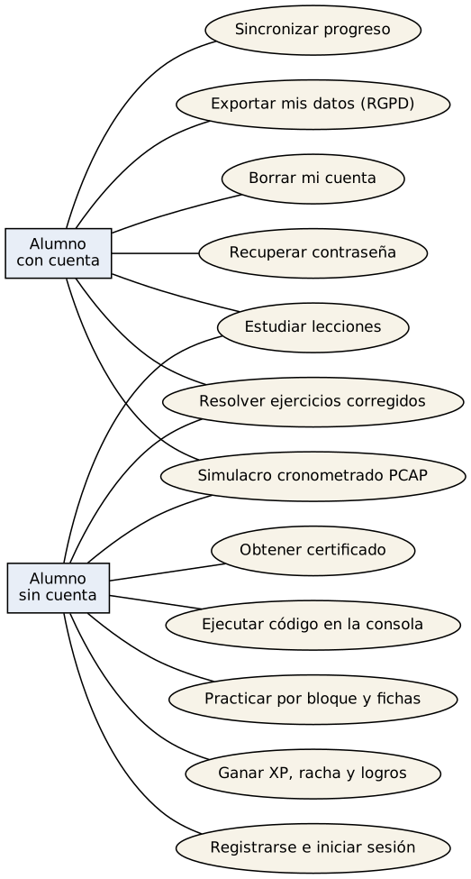
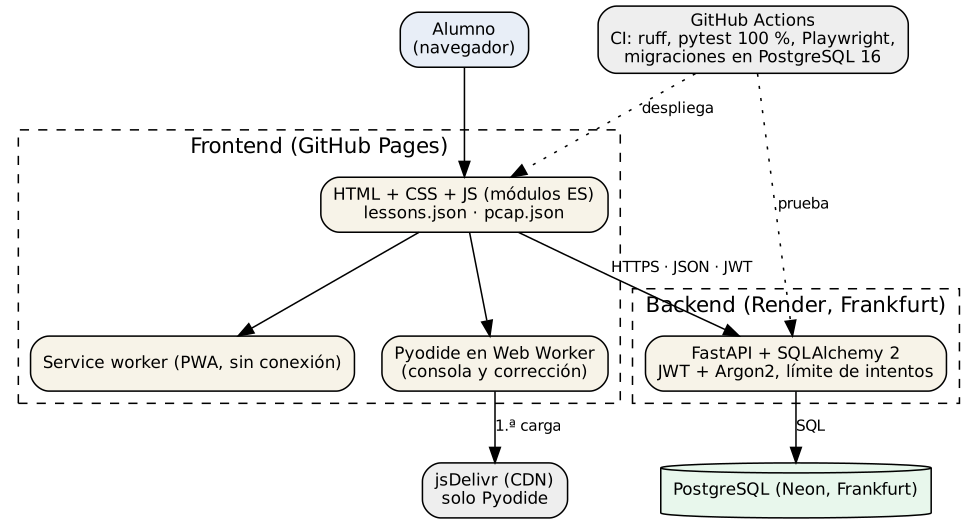
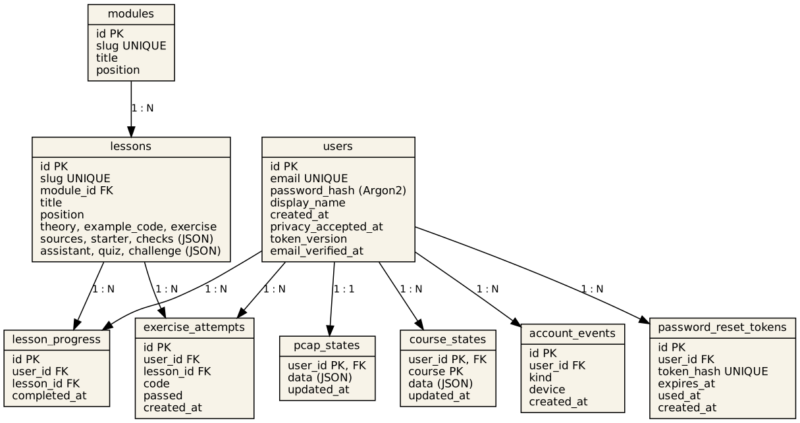

**Módulo:** 0616 Proyecto intermodular de desarrollo de aplicaciones web [VERIFY: confirma el nombre que usa tu centro] · **Ciclo formativo:** Técnico Superior en Desarrollo de Aplicaciones Web (DAW), modalidad [VERIFY: online o presencial] · **Centro:** [VERIFY: confirma el nombre; en documentos anteriores aparece «Alcazarén Formación»] · **Comunidad autónoma:** [VERIFY: confirma; el currículo que sigue la web es el de Castilla y León] · **Tutor/a del proyecto:** [VERIFY] · **Curso académico:** [VERIFY] · **Repositorio:** <https://github.com/Marbi8891/python-learning-dashboard> · **Demo:** <https://marbi8891.github.io/python-learning-dashboard/>

Los datos marcados `[VERIFY]` solo los puede poner el autor. La lista completa está en [`PENDIENTES.md`](PENDIENTES.md).

# Resumen

Python Learning Dashboard es una web gratuita para aprender a programar en Python, preparar el examen PCAP (Certified Associate in Python Programming) y estudiar varios módulos del ciclo de DAW. Tiene teoría propia, una consola de Python que funciona en el navegador, ejercicios que se corrigen solos, simulacros del examen, repaso espaciado y seis cursos de DAW: Programación, Java, Bases de datos, Entornos de desarrollo, JavaScript y Lenguajes de marcas.

Se puede usar sin cuenta. Si el alumno se registra, su progreso se guarda en el servidor y puede seguir desde otro dispositivo sin perder nada. La web muestra el currículo oficial de DAW de Castilla y León y relaciona cada módulo con las preguntas que el alumno ha practicado. La interfaz está en español y en inglés, y tiene opciones de lectura (letra grande, texto espaciado, contraste alto y sin animaciones).

Técnicamente es un frontend estático (HTML, CSS y JavaScript sin framework) publicado en GitHub Pages y una API REST hecha con FastAPI y PostgreSQL. Todo funciona con servicios gratuitos.

**Palabras clave:** Python, PCAP, DAW, FastAPI, PostgreSQL, PWA, Pyodide, accesibilidad, WCAG 2.2, RGPD, i18n.

**Abstract.** Python Learning Dashboard is a free website to learn Python, prepare for the PCAP exam and study several modules of the Spanish DAW vocational degree. It runs Python in the browser with Pyodide, grades exercises automatically and includes mock exams, spaced repetition and six DAW courses. The interface is available in Spanish and English. It is built as a static frontend plus a FastAPI/PostgreSQL REST API, tested automatically on every change and deployed with free services only.

# 1. Introducción

## 1.1 Por qué este proyecto

Cuando empecé a preparar Programación y el PCAP me encontré con que los recursos estaban muy repartidos: la documentación oficial no tiene ejercicios guiados, muchos cursos son de pago o están en inglés y los bancos de preguntas no explican por qué una respuesta es correcta. Además, para practicar hay que instalar Python, y eso a mucha gente que empieza le cuesta.

Con el resto de módulos de DAW pasa algo parecido: la teoría está en un sitio, los ejercicios en otro y no hay una forma sencilla de saber cuánto llevas de cada módulo.

## 1.2 Qué propongo

Una sola web, en español y gratuita, donde puedes leer la teoría, ejecutar código, hacer ejercicios que se corrigen al momento y hacer simulacros del examen, sin instalar nada y sin tener que registrarte. Cada pregunta de los cursos de DAW está asociada al módulo oficial del ciclo, así que el alumno ve qué parte del currículo ha trabajado.

## 1.3 Relación con los módulos del ciclo

El Proyecto Intermodular tiene que reunir lo aprendido en el ciclo. Esta es la relación entre cada módulo y lo que he hecho:

| Módulo | Qué he aplicado en el proyecto |
|---|---|
| 0485 Programación | Python en el backend y en los scripts que generan y comprueban el temario. Curso propio de Programación en Python y de Java. |
| 0484 Bases de datos | Modelo entidad-relación, PostgreSQL, SQLAlchemy, migraciones con Alembic y bloqueo optimista con número de versión. Curso de SQL con respuestas comprobadas en SQLite. |
| 0373 Lenguajes de marcas | HTML semántico, JSON como formato de intercambio y de datos del temario, Markdown propio y seguro. Curso de Lenguajes de marcas. |
| 0487 Entornos de desarrollo | Git con ramas y pull requests, pruebas automáticas, integración continua y documentación. Curso de Entornos de desarrollo. |
| 0612 Desarrollo web en entorno cliente | JavaScript con módulos ES, `fetch`, Web Workers, service worker (PWA), `localStorage` e internacionalización. Curso de JavaScript. |
| 0613 Desarrollo web en entorno servidor | API REST con FastAPI, autenticación, sesiones con cookie `HttpOnly`, límites de frecuencia y validación con Pydantic. |
| 0614 Despliegue de aplicaciones web | GitHub Pages, Docker, Render, Neon, variables de entorno y GitHub Actions. |
| 0615 Diseño de interfaces web | Sistema visual con tokens, diseño adaptable, tema claro y oscuro, accesibilidad WCAG 2.2 AA y usabilidad. |
| 1665 Digitalización aplicada a los sectores productivos | Servicios en la nube, cumplimiento del RGPD y de la LSSI y uso responsable de herramientas de IA. |
| 0179 Inglés profesional | Interfaz en inglés, documentación técnica y resumen en inglés. |

# 2. Objetivos

**Objetivo general.** Diseñar, desarrollar y publicar una web educativa para aprender Python, preparar el PCAP y estudiar los módulos de DAW, usando solo servicios gratuitos.

**Objetivos específicos y si se han cumplido.**

| Id | Objetivo | Estado |
|---|---|---|
| O-01 | Tener el temario del PCAP dividido según los bloques oficiales del examen. | Cumplido: 7 módulos y 27 lecciones. |
| O-02 | Ejecutar Python en el navegador, sin servidor, y poder cortar un programa que no termina. | Cumplido: Pyodide en un Web Worker, límite de 10 s y botón «Detener». |
| O-03 | Corregir los ejercicios automáticamente y comprobar que las respuestas del banco son correctas. | Cumplido: los scripts ejecutan cada respuesta al generar el temario. |
| O-04 | Poder usar la web sin cuenta, y que quien quiera pueda guardar su progreso en el servidor sin perderlo. | Cumplido: fusión sin pérdidas, versión por documento y aviso si algo no se ha guardado. |
| O-05 | Cumplir el RGPD: informar, descargar tus datos y borrar la cuenta. | Cumplido en el código; faltan datos del titular en el registro de tratamientos (ver 3.7). |
| O-06 | Que sea accesible (WCAG 2.2 AA) y funcione en el móvil. | Cumplido en las pruebas automáticas; falta la revisión manual con lector de pantalla. |
| O-07 | Cubrir varios módulos de DAW con contenido alineado con el currículo oficial. | Cumplido en parte: 6 cursos para 6 módulos de 9; faltan 0483, 0613, 0614 y 0615. |
| O-08 | Tener pruebas automáticas y despliegue continuo. | Cumplido. |
| O-09 | Que se pueda usar en inglés. | Cumplido para la interfaz; las lecciones siguen en español. |

**Fuera de alcance.** Certificados oficiales, pagos, tutorías en directo, ejecutar código en el servidor, un tutor con IA y una app móvil nativa. En el móvil se usa la web, que es adaptable y se puede instalar como PWA. Durante el desarrollo hice un prototipo de app Android y un tutor con IA, pero los retiré el 26 de octubre de 2026 para simplificar el proyecto y no depender de servicios de pago (ver 3.6).

# 3. Análisis

## 3.1 Actores

- **Alumno sin cuenta:** puede usar toda la web; el progreso se guarda en su navegador (`localStorage`).
- **Alumno con cuenta:** además guarda el progreso en el servidor, ve su historial, puede descargar sus datos y borrar su cuenta.
- **Administrador (el autor):** genera el contenido con los scripts, revisa los cambios y despliega.

## 3.2 Requisitos funcionales

| Id | Requisito |
|---|---|
| RF-01 | Ver el temario del PCAP organizado en módulos y lecciones (27 lecciones). |
| RF-02 | Ejecutar Python en una consola con `input()`, ver los errores con la línea y detener el programa. |
| RF-03 | Corregir los ejercicios con pruebas automáticas, explicando qué falta, con qué entrada se probó y qué mostró el programa, sin enseñar la solución. |
| RF-04 | Mini-quiz de 3 preguntas por lección con la explicación de cada opción. |
| RF-05 | Simulacro de 40 preguntas en 65 minutos con el reparto oficial de bloques. |
| RF-06 | Practicar por bloque, fichas de repaso (48) y panel de preparación. |
| RF-07 | Banco de 126 preguntas del PCAP en español o inglés. |
| RF-08 | Núcleo por conceptos: 22 conceptos y 131 ejercicios con la explicación de cada error. |
| RF-09 | Cursos de DAW: Programación, Java, Bases de datos, Entornos de desarrollo, JavaScript y Lenguajes de marcas (56 lecciones y 520 preguntas). |
| RF-10 | En las unidades completas: objetivos, teoría, ejemplo, ejercicio, errores frecuentes, resumen, solución explicada, mini-quiz, reto y fuentes. |
| RF-11 | Marcar una lección como completada y continuar donde se dejó. |
| RF-12 | Recursos complementarios con su licencia y fecha de verificación (24 recursos). |
| RF-13 | XP, niveles, racha y logros. |
| RF-14 | Repaso espaciado y plan de estudio según la fecha del examen. |
| RF-15 | Registro, inicio de sesión (también con Google), recuperación de contraseña y cierre de todas las sesiones. |
| RF-16 | Guardar el progreso en la cuenta y fusionarlo con el del navegador sin perder datos. |
| RF-17 | Panel del alumno con resumen, progreso por módulo oficial y actividad. |
| RF-18 | Descargar los datos personales en JSON y borrar la cuenta. |
| RF-19 | Currículo oficial de DAW (17 módulos, con sus resultados de aprendizaje y criterios de evaluación). |
| RF-20 | Portada pública (`#/portada`) con «Continúa donde lo dejaste» y página 404 propia. |
| RF-21 | Aspecto: idioma (español o inglés), tema claro, oscuro o automático, tres tamaños de letra, texto espaciado, contraste alto y sin animaciones. |

## 3.3 Requisitos no funcionales

| Id | Requisito | Cómo lo compruebo |
|---|---|---|
| RNF-01 | Accesibilidad WCAG 2.2 AA y uso completo con teclado | axe-core en las e2e, pruebas de foco, letra al 200 % y reflujo a 320 px |
| RNF-02 | Privacidad: una sola cookie técnica y los datos mínimos | Política de privacidad y prueba que la compara con el código (`test_privacy_policy.py`) |
| RNF-03 | Seguridad: Argon2, cookie `HttpOnly`, CSRF, límites de intentos y de escrituras | Pruebas del backend y auditoría de seguridad |
| RNF-04 | Integridad: el progreso no se pierde con dos pestañas, al cerrar sesión ni sin conexión | Pruebas unitarias y e2e de sincronización |
| RNF-05 | Fiabilidad: pruebas automáticas en cada cambio y 100 % de cobertura del backend | GitHub Actions |
| RNF-06 | Rendimiento: sin framework, Pyodide solo cuando se ejecuta código | Medidas de la Fase C (6.5) |
| RNF-07 | Funcionar sin conexión después de la primera visita | Service worker (PWA) |
| RNF-08 | Coste cero | Planes gratuitos (3.6) |

## 3.4 Casos de uso



## 3.5 Alternativas que valoré

- **Ejecutar el código en el servidor** en vez de en el navegador con Pyodide. Sería más potente, pero cuesta dinero, es peligroso ejecutar código de otras personas y no funcionaría sin conexión. Por eso elegí Pyodide.
- **Usar React o Vue** en vez de JavaScript sin framework. Como casi todo el contenido es estático, preferí no añadir un framework: la web pesa menos y no hay paso de compilación.
- **Cuenta obligatoria** o cuenta opcional. Elegí opcional para que se pueda empezar sin registrarse y para guardar menos datos personales.
- **Una biblioteca de traducción** (i18next) o una propia. Elegí una propia de un solo archivo (`i18n.js`): el español es el texto original y no hace falta poner claves en todo el HTML.
- **Un tutor con IA.** Lo probé con un modelo local (Ollama) y con proveedores de pago, pero lo retiré: el objetivo era no tener costes y un modelo local no se puede ofrecer en la web publicada. El asistente de cada lección tiene respuestas escritas y revisadas.

## 3.6 Planificación y costes

Las fechas salen del historial de Git: empieza el 25 de septiembre de 2026 y tiene commits en 19 días distintos hasta el 3 de noviembre. En `main` hay 158 commits y unas 70 pull requests. [VERIFY: si trabajaste antes en otro repositorio o en local, añade esas fechas; el tribunal puede preguntarlo.]

| Fase | Contenido | Fechas (según Git) | Horas |
|---|---|---|---|
| Análisis y diseño | Requisitos, arquitectura, modelo de datos | Antes del 25/09/2026 (no queda en Git) [VERIFY] | [VERIFY] |
| Web y consola | Lecciones, consola, ejercicios | 25/09 – 05/10 | [VERIFY] |
| Backend y cuentas | API, autenticación, RGPD, Google, recuperación de contraseña | 26/09 – 20/10 | [VERIFY] |
| Examen PCAP | Simulacros, fichas, repaso | 27/09 – 29/09 | [VERIFY] |
| Cursos de DAW y currículo | Temario, scripts que lo generan, currículo oficial | 29/09 – 26/10 | [VERIFY] |
| Auditorías y correcciones | Auditoría técnica, de seguridad y legal; sincronización sin pérdidas | 29/10 – 03/11 | [VERIFY] |
| Rediseño y accesibilidad | Sistema visual, portada, lección, consola, WCAG 2.2 | 02/11 – 03/11 | [VERIFY] |
| Idiomas | Interfaz en inglés y opciones de lectura | 02/11 | [VERIFY] |
| Lenguajes de marcas y Entornos | Unidades completas, progreso por lección, recursos | 02/11 – 03/11 | [VERIFY] |
| Pruebas y despliegue | Pruebas, CI, publicación | Todo el proyecto | [VERIFY] |
| Memoria y defensa | Documentación y presentación | 29/09 – 03/11 | [VERIFY] |

También hubo trabajo que no ha llegado a la versión final: una app Android (27/09 – 04/10) y un tutor con IA (06/10 – 20/10). Los retiré el 26 de octubre (pull request #62) para simplificar el proyecto.

**Costes.**

| Concepto | Proveedor | Coste |
|---|---|---|
| Frontend | GitHub Pages | 0 € |
| API | Render (plan gratuito, Frankfurt) | 0 € |
| Base de datos | Neon (plan gratuito, Frankfurt) | 0 € |
| Email de recuperación | [VERIFY: Brevo (API HTTPS) o Gmail (SMTP); el código admite los dos] | 0 € |
| Dominio | No tiene: usa el de GitHub Pages | 0 € |

El plan gratuito de Render apaga el servidor tras 15 minutos sin tráfico, y la primera petición tarda cerca de un minuto en despertarlo. Ese plan también bloquea los puertos SMTP, por eso el código puede enviar los emails por la API HTTPS de Brevo. Sin cuenta, la web no depende del backend.

## 3.7 Marco legal

La auditoría legal completa está en [`docs/AUDITORIA_LEGAL.md`](../AUDITORIA_LEGAL.md), con el plan en [`PLAN_ADECUACION_LEGAL.md`](../PLAN_ADECUACION_LEGAL.md) y los riesgos en [`RIESGOS_LEGALES.md`](../RIESGOS_LEGALES.md). No encontró ningún fallo grave (P0).

- **RGPD y LOPDGDD:** la política de privacidad describe el sistema real (Google, email de recuperación, almacenamiento en el navegador, plazos y proveedores) y una prueba automática falla si deja de coincidir con el código. El alumno puede descargar sus datos en JSON y borrar su cuenta. Hay registro de actividades de tratamiento ([`REGISTRO_TRATAMIENTOS.md`](../REGISTRO_TRATAMIENTOS.md)) y procedimiento de brechas ([`INCIDENTES.md`](../INCIDENTES.md)), con algunos datos del titular aún por completar.
- **LSSI-CE:** aviso legal con los datos del titular, que publica como particular, sin actividad comercial.
- **Cookies:** solo hay una propia, la de sesión, y solo si inicias sesión. Es técnica y necesaria, así que no hace falta banner. Google puede poner `g_state` solo si eliges «Continuar con Google», y está en la política.
- **Analítica:** preparada con GoatCounter, que no usa cookies, pero desactivada. Mientras siga así no se mide nada.
- **Terceros:** Pyodide se descarga de jsDelivr la primera vez que se usa la consola, así que jsDelivr recibe la IP. Está indicado en la política.
- **Propiedad intelectual:** el código es MIT y las fuentes (Inter, JetBrains Mono y Fraunces) son OFL. Las explicaciones y las preguntas son propias, y los recursos externos se enlazan con su licencia. PCAP es una marca de Python Institute; el proyecto no tiene relación con ellos y el certificado que genera la web no es oficial.
- **Si algún día se cobrara:** harían falta condiciones de contratación, desistimiento y facturación. Hoy no aplican (plan, apartado P1-C).

# 4. Diseño

## 4.1 Arquitectura



El frontend es estático y se publica en GitHub Pages. El backend en FastAPI se despliega en Render (Frankfurt) y la base de datos PostgreSQL está en Neon (Frankfurt), así los datos se quedan en la UE. Python se ejecuta en el navegador del alumno, dentro de un Web Worker.

El temario no se guarda en la base de datos como fuente: lo generan scripts de Python en `frontend/data/` (JSON), y la web lo lee directamente. Así el contenido se revisa como el código, en pull requests.

## 4.2 Modelo de datos



Las tablas de contenido (`modules`, `lessons`) se rellenan desde `lessons.json` con un script (`seed.py`). El progreso, los intentos, los tokens y el historial de la cuenta (`account_events`: inicios de sesión y cambios de seguridad, sin IP) dependen del usuario y se borran con él. `users.email_verified_at` indica si el email está comprobado.

La preparación del PCAP y el estado de cada curso se guardan como un documento JSON por usuario, con una columna `version`. El formato cambia a menudo y así no hace falta una migración cada vez; por ejemplo, el progreso por lección de los cursos de DAW (`done` y `lastLesson`) se añadió sin tocar la base de datos. Los tokens de recuperación se guardan como hash y caducan a los 30 minutos.

## 4.3 API REST

| Método | Ruta | Descripción |
|---|---|---|
| GET | `/api/v1/health` | Estado del servicio |
| GET | `/api/v1/modules` | Módulos con sus lecciones |
| GET | `/api/v1/lessons/{slug}` | Lección completa |
| POST | `/api/v1/auth/register` | Crear cuenta (hay que aceptar la privacidad) |
| POST | `/api/v1/auth/login` | Iniciar sesión |
| POST | `/api/v1/auth/google` | Entrar con Google |
| POST | `/api/v1/auth/logout`, `/logout-all` | Cerrar la sesión, o todas las sesiones |
| POST | `/api/v1/auth/password-reset/request` y `/confirm` | Recuperar la contraseña |
| GET | `/api/v1/users/me`, `/me/activity`, `/me/export` | Datos del usuario, historial de la cuenta y exportación RGPD |
| POST | `/api/v1/users/me/password` | Cambiar la contraseña |
| POST | `/api/v1/users/me/delete` | Borrar la cuenta (con la contraseña o, en cuentas de Google, una credencial reciente de Google) |
| GET | `/api/v1/progress` | Progreso de las lecciones |
| PUT, DELETE | `/api/v1/progress/{slug}` | Marcar o desmarcar una lección |
| POST | `/api/v1/progress/import` | Subir el progreso local al iniciar sesión |
| POST, GET | `/api/v1/lessons/{slug}/attempts` | Intentos de ejercicio |
| GET, PUT | `/api/v1/pcap-state` | Preparación del PCAP |
| GET, PUT | `/api/v1/course-state/{curso}` | Progreso de los cursos de DAW, del núcleo por conceptos (`learn`) y de la gamificación (`game`) |
| GET | `/api/v1/dashboard`, `/dashboard/activity` | Datos del panel del alumno e historial de aprendizaje |

Cada `PUT` de `pcap-state` y `course-state` dice qué versión leyó la app. Si otra pestaña o dispositivo guardó entre medias, el servidor responde 409 y la app vuelve a leer, fusiona y reintenta. Además, hay un límite de 120 guardados por usuario y minuto (429). FastAPI genera la documentación interactiva (OpenAPI) en `/docs`, y está resumida en [`docs/API.md`](../API.md).

## 4.4 Seguridad

- Las contraseñas se guardan con Argon2id y se rechazan las contraseñas más comunes.
- La sesión es un JWT dentro de una cookie `HttpOnly` (`__Host-pld_session`) que caduca a los 30 minutos y se renueva mientras se usa la web, con un máximo de 12 horas. JavaScript no puede leer el token. Las peticiones que cambian datos llevan una cabecera extra para evitar CSRF.
- Al cambiar la contraseña se cierran todas las sesiones (`token_version`).
- Hay límites de intentos de inicio de sesión por IP y por cuenta, y de escrituras por usuario.
- CORS solo deja pasar los orígenes del frontend, y la API envía cabeceras de seguridad (`X-Content-Type-Options`, `X-Frame-Options`, `Strict-Transport-Security`...). El frontend tiene una política CSP.
- El contenido que llega de fuera se escapa al pintarlo: el Markdown es propio y no admite HTML (`markdown.js`) y `progress-guard.js` descarta datos raros del navegador o de la cuenta.
- El código de los ejercicios solo se ejecuta en el navegador del alumno, nunca en el servidor. Tras cada ejecución se restauran las funciones integradas de Python, y la salida tiene un tope.
- Si entra otra persona en el mismo navegador, el progreso del primero se aparta sin borrarlo y no se mezcla con su cuenta.

La auditoría de seguridad (RT-001 a RT-006) no encontró fallos graves. Lo que queda son mejoras preventivas y límites conocidos, explicados en 9.2.

## 4.5 Interfaz

El sistema visual está documentado en [`docs/DISENO.md`](../DISENO.md) y todos sus valores están en un solo archivo (`frontend/css/tokens.css`). Sus principios son: el contenido manda, un color tiene un solo significado (ámbar para la acción, verde para el progreso, rojo para los errores, siempre acompañados de texto o icono), no se muestran cifras que la web no pueda calcular y la accesibilidad va por defecto.

- **Identidad:** grafito y ámbar Python en el tema oscuro, y un papel cálido en el claro (no es una inversión del oscuro). Inter para el texto, Fraunces para los titulares y JetBrains Mono para el código, alojadas en el propio proyecto.
- **Contraste:** calculado para cada par de colores en los dos temas; todos llegan a AA.
- **Lección en tres áreas:** índice «En esta página», contenido y consola. En pantallas anchas la consola aparece al lado.
- **Consola:** barra con el nombre del archivo y el estado, «Ejecutar» como acción principal, «Detener» y los errores aparte de la salida.
- **Accesibilidad:** enlace para saltar al contenido, todo con teclado, foco visible y que no queda tapado, zonas táctiles de 44 px, errores de formulario asociados a su campo y respeto por `prefers-reduced-motion`.
- **Idiomas:** la interfaz se traduce con `i18n.js` y `frontend/i18n/en.json`. El código lleva `translate="no"` para que ningún traductor cambie un programa (ver [`docs/IDIOMAS.md`](../IDIOMAS.md)).

Las capturas de antes y después del rediseño están en los archivos del proyecto. [VERIFY: elige dos o tres capturas para el documento final, por ejemplo la portada y una lección en tema claro y oscuro.]

# 5. Implementación

## 5.1 Tecnologías

| Capa | Tecnología |
|---|---|
| Frontend | HTML, CSS y JavaScript (módulos ES, sin framework), highlight.js, Pyodide |
| Backend | Python 3.11 o superior, FastAPI, SQLAlchemy 2, Alembic, Pydantic, PyJWT, argon2-cffi |
| Datos | PostgreSQL (producción) y SQLite (local y pruebas) |
| Calidad | pytest, Ruff, node --test, Playwright, axe-core, pip-audit, npm audit, GitHub Actions |
| Despliegue | GitHub Pages, Render, Neon, Docker |

## 5.2 Estructura del repositorio

- `frontend/`: la web, los textos en inglés (`frontend/i18n/`) y los datos del temario (`frontend/data/`).
- `backend/`: la API, las migraciones y sus pruebas.
- `scripts/`: los scripts que generan y comprueban el temario (`courses/`, `learning/`, `curriculum/`, `resources/`), el inspector de la web y el arranque en local.
- `e2e/`: pruebas de extremo a extremo y de accesibilidad.
- `tests/unit/`: pruebas unitarias del JavaScript.
- `docs/`: despliegue, API, pruebas, diseño, idiomas, auditorías, documentos legales y esta memoria.

## 5.3 Partes más interesantes

**Ejecutar Python en el navegador.** Pyodide funciona dentro de un Web Worker, así la página no se queda bloqueada. Si un programa tarda más de 10 segundos, o el alumno pulsa «Detener», el worker se para y se crea otro. Pyodide solo se descarga cuando el alumno ejecuta código, y con una red lenta la consola avisa de que sigue descargando.

**Temario comprobado.** El temario no se escribe a mano en los JSON: se genera con scripts de Python. Los scripts ejecutan el código de cada respuesta (en Python, SQLite, Node o Java) y fallan si la salida no es la que se espera. Cada pregunta tiene un id estable guardado en `scripts/courses/ids.lock.json` (609 ids), para que cambiar el temario no borre el progreso de nadie. En la integración continua se comprueba que el JSON publicado está al día.

**Progreso sin pérdidas.** Si no hay sesión, todo se guarda en `localStorage`. Al iniciar sesión se fusionan el progreso local y el del servidor, y no se sube nada hasta haber fusionado (`sync-gate.js`). Cada documento lleva versión y el servidor responde 409 si otra pestaña guardó antes. Si una subida falla, se reintenta y se avisa; al cerrar sesión no se borra nada que el servidor no tenga (`uploader.js`). Son los fallos AUD-001 y SYNC-01 de las auditorías, reproducidos con pruebas antes de corregirlos.

**Cursos de DAW con unidades completas.** Lenguajes de marcas (0373) y Entornos de desarrollo (0487) tienen unidades con objetivos, errores frecuentes, resumen y solución explicada, alineadas con los resultados de aprendizaje del Real Decreto 405/2023. En todos los cursos el alumno marca cada lección como completada y el curso le ofrece «Continuar».

**Currículo oficial de DAW.** `scripts/curriculum/` genera el catálogo de los 17 módulos de la Orden EDU/1311/2024 de Castilla y León con los resultados de aprendizaje y criterios de evaluación del Real Decreto 405/2023 (`#/daw/curriculo`). El panel del alumno muestra cuántas preguntas ha practicado y domina por módulo. La auditoría del temario ([`docs/AUDITORIA_TEMARIO_DAW.md`](../AUDITORIA_TEMARIO_DAW.md)) dice de dónde sale cada contenido.

**Asistente de la lección.** Cada lección tiene un asistente con preguntas frecuentes, una pista del ejercicio y un enlace al tema siguiente (`frontend/js/assistant.js`). No es una IA: las respuestas están escritas y revisadas, así que no hace falta ningún servicio externo.

**Internacionalización sin claves.** El español es el texto original. Con otro idioma, `i18n.js` sustituye cada texto que esté en el diccionario, y un `MutationObserver` traduce también lo que se pinta después. Una prueba unitaria falla si un texto fijo de la página no tiene traducción.

**PWA.** El service worker sirve la web pidiendo primero a la red y, si no hay conexión, desde la caché. Pyodide se guarda en una caché aparte.

**Versión para Windows.** `Iniciar-Dashboard.bat` arranca la web y la API en el propio ordenador (ver [`docs/EJECUTAR-EN-WINDOWS.md`](../EJECUTAR-EN-WINDOWS.md)).

## 5.4 Metodología de trabajo

He trabajado con ramas y pull requests: cada cambio va en una rama, pasa todas las pruebas en GitHub Actions y se revisa antes de fusionarlo en `main`, que publica la web. Los cambios grandes se han hecho por fases (por ejemplo, la auditoría de la plataforma de la A a la G), primero auditando y reproduciendo cada fallo con una prueba y después corrigiéndolo.

# 6. Pruebas

Los comandos están en [`docs/TESTING.md`](../TESTING.md).

## 6.1 Resumen

| Tipo | Qué prueba | Resultado (3/11/2026) |
|---|---|---|
| Backend (pytest) | API, autenticación, RGPD, sesiones, límites, migraciones, contenido, currículo, cursos y coherencia de la política de privacidad | 649 pruebas, 100 % de cobertura |
| Frontend (node --test) | Aprendizaje, repaso, panel, fusión del progreso, subidas, Markdown seguro, i18n y gamificación | 130 pruebas |
| End-to-end (Playwright) | La web entera con el backend de verdad | 197 pruebas en 21 ficheros |
| Accesibilidad | axe-core con WCAG 2.2 A/AA, foco, letra al 200 %, reflujo a 320 px | 0 infracciones en 15 rutas, móvil y escritorio, tema claro y oscuro |
| Temario | Cada respuesta se ejecuta al generar | Cursos, núcleo, currículo y recursos al día |
| Estilo de código | Ruff | Sin errores |
| Migraciones | Alembic contra PostgreSQL 16 | Automática en CI |
| Dependencias | pip-audit y npm audit | Sin vulnerabilidades conocidas altas |

## 6.2 Integración continua

En cada `push` y pull request GitHub Actions pasa el lint, las pruebas del backend con cobertura mínima del 100 %, la comprobación del temario, las migraciones en PostgreSQL, las pruebas unitarias, las end-to-end y la auditoría de dependencias. Cuando se fusiona en `main`, la web se publica sola en GitHub Pages.

## 6.3 Pruebas manuales

Algunas comprobaciones ya las hace una prueba automática en Chromium. Las pruebas manuales en un dispositivo real se anotan aquí con la fecha y el resultado.

| Prueba | Prueba automática | Dispositivo | Resultado manual |
|---|---|---|---|
| Navegación completa a 375 px | Sí: no hay desbordamiento a 375 y 320 px | [VERIFY] | [VERIFY] |
| Recorrido solo con teclado | Sí: salto al contenido, Esc en diálogos y foco tras cada acción | [VERIFY] | [VERIFY] |
| Lector de pantalla (VoiceOver o NVDA) | No | [VERIFY] | [VERIFY] |
| Página 404 | Sí: `e2e/navigation.spec.js` | [VERIFY] | [VERIFY] |
| Uso sin conexión (PWA) | Sí: `e2e/study.spec.js` corta la red y recarga | [VERIFY] | [VERIFY] |
| Interfaz en inglés | Sí: `e2e/idiomas.spec.js` | [VERIFY] | [VERIFY] |

## 6.4 Accesibilidad

La Fase C de la auditoría pasó axe-core con las reglas de WCAG 2.2 A/AA en 15 rutas, en móvil y escritorio y en los dos temas, sin infracciones. También corrigió lo que axe no ve: dónde queda el foco al comprobar un quiz o cerrar una confirmación, la letra al 200 % y los errores de formulario (`aria-invalid`). Que axe no encuentre errores no significa que la web cumpla WCAG 2.2 AA: falta la revisión manual con lector de pantalla, con la guía de VoiceOver preparada.

## 6.5 Rendimiento

Medido en Chromium con el servidor local, sin compresión (GitHub Pages sí comprime):

| Medida | Equipo normal | Móvil modesto simulado |
|---|---|---|
| Primer contenido en pantalla (FCP) | 0,3 s | 1,8 s |
| Mayor contenido en pantalla (LCP) en la portada | 0,9 s | 5,9 s |
| Cambio de ruta | 30-80 ms | 50-210 ms |
| Primera ejecución de Python | 4 s | unos 30 s con compresión |

Falta medir la web publicada con Lighthouse (DevTools → Lighthouse, modo móvil y escritorio):

| Fecha | Modo | Rendimiento | Accesibilidad | Buenas prácticas | SEO |
|---|---|---|---|---|---|
| [VERIFY] | Móvil | [VERIFY] | [VERIFY] | [VERIFY] | [VERIFY] |
| [VERIFY] | Escritorio | [VERIFY] | [VERIFY] | [VERIFY] | [VERIFY] |

## 6.6 Auditorías

| Auditoría | Documento | Resultado |
|---|---|---|
| Técnica (fases A a C) | [`AUDITORIA_TECNICA.md`](../AUDITORIA_TECNICA.md) | P0 de sincronización (AUD-001, SYNC-01) reproducidos y corregidos; quedan riesgos menores (9.2) |
| Seguridad | RT-001 a RT-006 | Sin fallos graves; mejoras preventivas pendientes |
| Legal | [`AUDITORIA_LEGAL.md`](../AUDITORIA_LEGAL.md) | Sin P0; política corregida; faltan datos del titular |
| Temario de DAW (fase D) | [`AUDITORIA_TEMARIO_DAW.md`](../AUDITORIA_TEMARIO_DAW.md) | Ids estables, origen de cada contenido y pruebas de coherencia |

# 7. Despliegue

El frontend se publica en GitHub Pages con el workflow `pages.yml` cada vez que se fusiona en `main`. El backend es un contenedor Docker en Render, con PostgreSQL en Neon, y está definido en `render.yaml`. Las variables sensibles (`JWT_SECRET`, la base de datos, el email, el id de cliente de Google) se configuran en Render y nunca se suben al repositorio. Los pasos están en [`docs/DEPLOY.md`](../DEPLOY.md).

**Instalación en local.**

- **Uso rápido (Windows):** doble clic en `Iniciar-Dashboard.bat` (hace falta Python 3.11 o superior).
- **Desarrollo:**

```
cd backend
python -m venv .venv && .venv\Scripts\activate
pip install -r requirements-dev.txt
copy .env.example .env      # define JWT_SECRET
alembic upgrade head && python -m app.seed
uvicorn app.main:app --reload

cd ../frontend
python -m http.server 5500
```

- **Con Docker:** `JWT_SECRET=<valor> docker compose up --build`.
- **Pruebas:** `cd backend && python -m pytest --cov=app`, `npm ci && npm run test:unit` y `npx playwright install chromium && npm run test:e2e`.

# 8. Manual de usuario

1. **Empezar.** Abre la web. La portada presenta la web y, si ya habías estudiado, te ofrece «Continúa donde lo dejaste». Pulsa «Empezar a aprender»: la página «¿Qué estudio ahora?» te propone qué hacer.
2. **Estudiar una lección.** Lee la teoría, prueba el ejemplo con «Probar en la consola» y haz el ejercicio. Si tu programa no termina, pulsa «Detener». Al comprobarlo, la web te dice qué falta y qué mostró tu programa. Si pasa las pruebas, la lección queda completada.
3. **Mini-quiz.** Responde las tres preguntas. Cada respuesta explica por qué es correcta o no.
4. **Examen PCAP.** Elige simulacro (40 preguntas, 65 minutos), práctica por bloque o fichas de repaso.
5. **Cursos de DAW.** En «DAW» elige un curso. Al terminar cada lección, márcala como completada y usa «Continuar» para seguir. Lenguajes de marcas y Entornos tienen además objetivos, errores frecuentes, resumen y solución explicada. En «Currículo» ves los módulos oficiales.
6. **Cuenta (opcional).** Crea una cuenta con email o con Google para guardar tu progreso en el servidor. En «Mi panel» ves tu progreso por módulo y tu actividad, puedes descargar tus datos o borrar la cuenta. Si al cerrar sesión hay algo sin guardar, la web te avisa y te deja reintentar.
7. **Aspecto.** Cambia el idioma, el tema, el tamaño de letra y las opciones de lectura (texto espaciado, contraste alto, sin animaciones).
8. **Sin conexión.** Desde el navegador puedes instalar la web y usarla sin conexión las páginas que ya has visitado.

[VERIFY: añade capturas de los pasos 1, 2 y 6 si tu centro pide un manual con imágenes.]

# 9. Conclusiones

## 9.1 Conclusiones

He hecho una web con su API que cumple los objetivos: el temario del PCAP y de seis módulos de DAW, Python en el navegador, corrección automática que explica el fallo, cuenta opcional con RGPD, progreso que no se pierde, accesibilidad comprobada, interfaz en dos idiomas y funcionamiento sin conexión, todo con coste cero.

Lo que más he aprendido es a separar un frontend estático y ligero de un backend pequeño que solo hace lo que necesita servidor (cuentas y progreso), a tener pruebas automáticas desde el principio y a auditar antes de corregir: reproducir cada fallo con una prueba que falla, arreglarlo y dejar la prueba para que no vuelva. También he aprendido que simplificar es una decisión de diseño: retiré la app Android y el tutor con IA porque complicaban el proyecto sin cumplir mejor los objetivos.

[VERIFY: añade una o dos frases personales: qué te costó más y qué harías distinto.]

## 9.2 Limitaciones

- Falta la revisión manual de accesibilidad con lector de pantalla y medir la web publicada con Lighthouse.
- El backend gratuito tarda en arrancar después de un rato sin uso.
- El progreso y la XP los calcula el navegador: el servidor valida la forma, el tamaño y la frecuencia, pero no el contenido. Por eso la XP y el certificado no se presentan como verificados.
- El Web Worker evita que la página se congele, pero no es una barrera de seguridad completa (RT-002, RT-005): solo afecta al propio navegador del alumno.
- Los límites de intentos se guardan en memoria, así que solo valen con una instancia del servidor.
- Un `PUT` sin versión todavía sobrescribe (SYNC-03), para no romper pestañas abiertas con una versión antigua.
- Las lecciones están solo en español.
- Cuatro módulos técnicos del ciclo (0483, 0613, 0614 y 0615) aún no tienen curso en la web.

## 9.3 Líneas futuras

- Completar las unidades del resto de cursos, empezando por Bases de datos, y añadir Diseño de interfaces web (0615).
- Alojar Pyodide en el propio proyecto con control de integridad y dar al Worker su propia CSP.
- Traducir las lecciones al inglés.
- Activar la analítica sin cookies, que ya está preparada.
- Hacer las pruebas con usuarios reales y con lector de pantalla.

## 9.4 Uso de herramientas de IA

- **Git y GitHub:** control de versiones, pull requests, GitHub Actions (CI) y GitHub Pages.
- **Claude Code (asistente de IA):** 58 de los 158 commits de `main` llevan una marca explícita de Claude Code; los commits que se fusionan agrupados no siempre la conservan, así que la parte hecha con su ayuda es mayor.
- [VERIFY: completa el editor o IDE que has usado (por ejemplo, PyCharm o VS Code) y explica con tus palabras para qué partes usaste la IA y qué hiciste tú: decidir qué construir, revisar, probar y aprobar cada cambio. Sigue lo que pida tu centro sobre el uso de IA.]

# 10. Bibliografía y fuentes

**Normativa educativa**

- Real Decreto 405/2023, de 29 de mayo (BOE-A-2023-13221): actualiza el título de DAW y sus resultados de aprendizaje.
- Real Decreto 500/2024, de 21 de mayo (BOE-A-2024-10685): módulos transversales y Proyecto intermodular.
- Real Decreto 659/2023, de 18 de julio: ordenación del sistema de Formación Profesional.
- Orden EDU/1311/2024, de 26 de noviembre (BOCYL núm. 234, 2/12/2024): currículo de DAW en Castilla y León.
- Ley Orgánica 3/2022, de 31 de marzo, de ordenación e integración de la Formación Profesional.

**Normativa legal**

- Reglamento (UE) 2016/679 (RGPD) y Ley Orgánica 3/2018 (LOPDGDD).
- Ley 34/2002 (LSSI-CE).
- W3C. *Web Content Accessibility Guidelines (WCAG) 2.2*.

**Técnica**

- Python Institute. *PCAP: Certified Associate in Python Programming, exam syllabus* (PCAP-31-03).
- Python Software Foundation. *The Python Tutorial* y *Python Language Reference*.
- Severance, C. *Python para todos* (PY4E).
- Documentación oficial de FastAPI, SQLAlchemy, Alembic, Pydantic, Pyodide y Playwright.
- MDN Web Docs (JavaScript, Service Workers, Web Workers, internacionalización).
- Deque. *axe-core rules*.
- Los recursos complementarios de los cursos, con su licencia, están en `frontend/data/resources.json`.

# Anexo A. Documentación del proyecto

| Documento | Qué contiene |
|---|---|
| [`DEMO-Y-DEFENSA.md`](../DEMO-Y-DEFENSA.md) | Guion de la defensa, preguntas probables y lista de comprobación |
| [`PENDIENTES.md`](PENDIENTES.md) | Datos que tiene que completar el autor |
| [`API.md`](../API.md), [`auth.md`](../auth.md) | API y autenticación |
| [`DEPLOY.md`](../DEPLOY.md), [`EJECUTAR-EN-WINDOWS.md`](../EJECUTAR-EN-WINDOWS.md) | Despliegue e instalación |
| [`TESTING.md`](../TESTING.md) | Pruebas |
| [`DISENO.md`](../DISENO.md), [`IDIOMAS.md`](../IDIOMAS.md) | Sistema visual e idiomas |
| [`PLAN-CURRICULO-DAW.md`](../PLAN-CURRICULO-DAW.md), [`AMPLIAR-TEMARIO-DAW.md`](../AMPLIAR-TEMARIO-DAW.md), [`AUDITORIA_TEMARIO_DAW.md`](../AUDITORIA_TEMARIO_DAW.md) | Temario de DAW |
| [`AUDITORIA_TECNICA.md`](../AUDITORIA_TECNICA.md) | Auditoría técnica |
| [`AUDITORIA_LEGAL.md`](../AUDITORIA_LEGAL.md), [`PLAN_ADECUACION_LEGAL.md`](../PLAN_ADECUACION_LEGAL.md), [`RIESGOS_LEGALES.md`](../RIESGOS_LEGALES.md), [`REGISTRO_TRATAMIENTOS.md`](../REGISTRO_TRATAMIENTOS.md), [`INCIDENTES.md`](../INCIDENTES.md) | Documentación legal |
