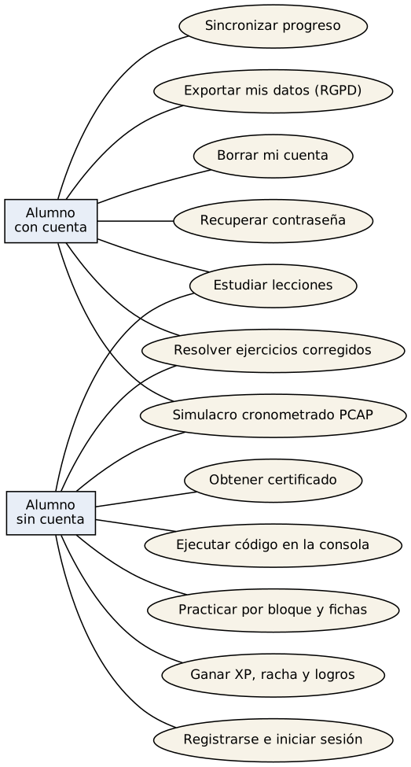
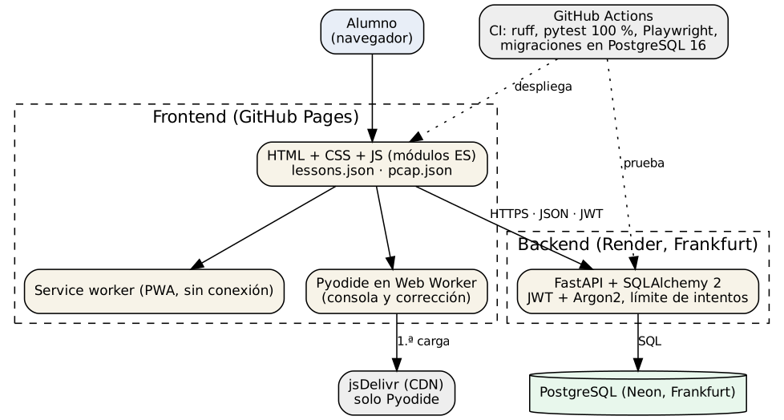
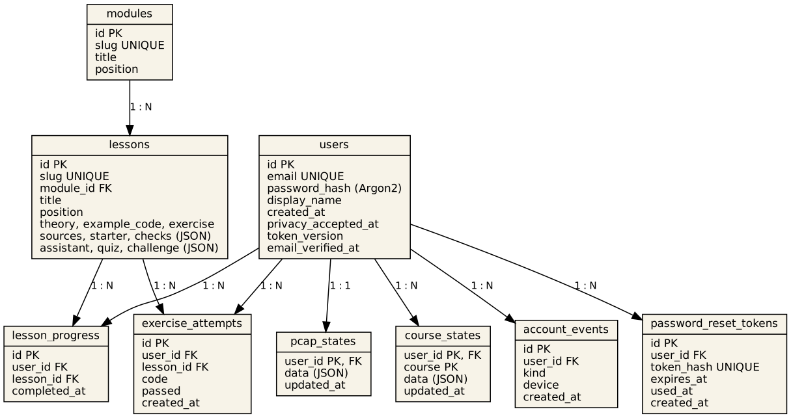

**Ciclo formativo:** Desarrollo de Aplicaciones Web (DAW), modalidad online · **Centro:** Alcazarén Formación · **Tutor/a:** [VERIFY] · **Curso:** [VERIFY] · **Repositorio:** <https://github.com/Marbi8891/python-learning-dashboard> · **Demo:** <https://marbi8891.github.io/python-learning-dashboard/>

# Resumen

Python Learning Dashboard es una web para aprender a programar en Python y preparar el examen PCAP (Certified Associate in Python Programming) y la parte de programación de DAW. Tiene teoría propia, una consola de Python que funciona en el navegador, ejercicios que se corrigen solos, simulacros del examen y repaso espaciado. También incluye cursos de otros módulos del ciclo (Bases de datos, Entornos de desarrollo, JavaScript y Java).

Se puede usar sin cuenta. Si el alumno se registra, su progreso se guarda en el servidor y puede verlo desde cualquier dispositivo.

Técnicamente es un frontend estático (HTML, CSS y JavaScript) publicado en GitHub Pages y una API REST hecha con FastAPI y PostgreSQL.

**Palabras clave:** Python, PCAP, DAW, FastAPI, PostgreSQL, PWA, Pyodide, accesibilidad, RGPD.

**Abstract.** Python Learning Dashboard is a website to learn Python and prepare for the PCAP exam and the programming module of the Spanish DAW vocational degree. It runs Python in the browser with Pyodide, grades exercises automatically and includes mock exams and spaced repetition. It is built as a static frontend plus a FastAPI/PostgreSQL REST API.

# 1. Introducción

## 1.1 Por qué este proyecto

Cuando empecé a preparar Programación y el PCAP me encontré con que los recursos estaban muy repartidos: la documentación oficial no tiene ejercicios guiados, muchos cursos son de pago o están en inglés y los bancos de preguntas no explican por qué una respuesta es correcta. Además, para practicar hay que instalar Python, y eso a mucha gente que empieza le cuesta.

Con el resto de módulos de DAW pasa algo parecido: la teoría está en un sitio, los ejercicios en otro y no hay una forma sencilla de saber cuánto llevas.

## 1.2 Qué propongo

Una sola web en español donde puedes leer la teoría, ejecutar código, hacer ejercicios que se corrigen al momento y hacer simulacros del examen, sin instalar nada y sin tener que registrarte.

## 1.3 Relación con el ciclo

En el proyecto he usado contenidos de varios módulos:

- **Programación:** Python en el backend y en los scripts que generan el temario.
- **Bases de datos:** modelo entidad-relación, PostgreSQL, SQLAlchemy y migraciones con Alembic.
- **Desarrollo web en entorno cliente:** JavaScript con módulos ES, consumo de una API con `fetch`, Web Workers y PWA.
- **Desarrollo web en entorno servidor:** API REST con FastAPI, autenticación y sesiones.
- **Diseño de interfaces web:** diseño adaptable, tema claro y oscuro, accesibilidad.
- **Despliegue de aplicaciones web:** GitHub Pages, Docker, Render y GitHub Actions.
- **Entornos de desarrollo:** Git, ramas, pruebas automáticas e integración continua.

# 2. Objetivos

**Objetivo general.** Hacer y publicar una web educativa para aprender Python y preparar el PCAP y los módulos de DAW.

**Objetivos específicos.**

1. Tener el temario del PCAP dividido según los bloques oficiales del examen.
2. Poder ejecutar Python en el navegador, sin servidor, y cortar los bucles infinitos.
3. Corregir los ejercicios automáticamente y comprobar que las respuestas del banco son correctas.
4. Que se pueda usar sin cuenta, y que quien quiera pueda registrarse para guardar su progreso.
5. Cumplir el RGPD: descargar tus datos y borrar la cuenta.
6. Que sea accesible (WCAG 2.1 AA) y funcione en móvil.
7. Tener pruebas automáticas y despliegue continuo.

**Fuera de alcance.** Certificados oficiales, pagos, tutorías en directo, ejecutar código en el servidor y una app móvil nativa.

# 3. Análisis

## 3.1 Actores

- **Alumno sin cuenta:** puede usar toda la web; el progreso se guarda en su navegador (`localStorage`).
- **Alumno con cuenta:** además guarda el progreso en el servidor, puede descargar sus datos y borrar su cuenta.
- **Administrador (yo):** genera el contenido con los scripts y despliega.

## 3.2 Requisitos funcionales

| Id | Requisito |
|---|---|
| RF-01 | Ver el temario organizado en módulos y lecciones (27 lecciones del PCAP). |
| RF-02 | Ejecutar Python en una consola con `input()` y ver los errores con la línea. |
| RF-03 | Corregir los ejercicios con pruebas automáticas; al superarlas se completa la lección. |
| RF-04 | Mini-quiz de 3 preguntas por lección con la explicación de cada opción. |
| RF-05 | Simulacro de 40 preguntas en 65 minutos con el reparto oficial de bloques. |
| RF-06 | Practicar por bloque, fichas de repaso y panel de preparación. |
| RF-07 | Banco de 126 preguntas en español o inglés. |
| RF-08 | Núcleo por conceptos: 22 conceptos y 131 ejercicios con la explicación de cada error. |
| RF-09 | Cursos de DAW: Programación, Bases de datos, Entornos, JavaScript y Java. |
| RF-10 | XP, niveles, racha y logros. |
| RF-11 | Repaso espaciado y plan de estudio según la fecha del examen. |
| RF-12 | Registro, inicio de sesión (también con Google) y recuperación de contraseña. |
| RF-13 | Guardar el progreso en la cuenta. |
| RF-14 | Panel del alumno con resumen, progreso y actividad. |
| RF-15 | Descargar los datos personales en JSON y borrar la cuenta. |
| RF-16 | Tema claro, oscuro o automático y tres tamaños de letra. |

## 3.3 Requisitos no funcionales

| Id | Requisito | Cómo lo compruebo |
|---|---|---|
| RNF-01 | Accesibilidad WCAG 2.1 AA y uso con teclado | Pruebas de Playwright con axe-core |
| RNF-02 | Privacidad: una sola cookie técnica y los datos mínimos | Política de privacidad, exportación y borrado |
| RNF-03 | Seguridad: Argon2, sesión en cookie `HttpOnly`, límite de intentos | Pruebas del backend |
| RNF-04 | Fiabilidad: pruebas automáticas en cada cambio | GitHub Actions |
| RNF-05 | Rendimiento: sin framework y con caché del service worker | Lighthouse (ver 6.5) |
| RNF-06 | Funcionar sin conexión después de la primera visita | Service worker (PWA) |

## 3.4 Casos de uso



## 3.5 Alternativas que valoré

- **Ejecutar el código en el servidor** en vez de en el navegador con Pyodide. Sería más potente, pero cuesta dinero, es peligroso ejecutar código de otras personas y no funcionaría sin conexión. Por eso elegí Pyodide.
- **Usar React o Vue** en vez de JavaScript sin framework. Como casi todo el contenido es estático, preferí no añadir un framework: la web pesa menos y no hay paso de compilación.
- **Cuenta obligatoria** o cuenta opcional. Elegí opcional para que se pueda empezar sin registrarse y para guardar menos datos personales.

# 4. Diseño

## 4.1 Arquitectura



El frontend es estático y se publica en GitHub Pages. El backend en FastAPI se despliega en Render (Frankfurt) y la base de datos PostgreSQL está en Neon (Frankfurt), así los datos se quedan en la UE. Python se ejecuta en el navegador del alumno, dentro de un Web Worker.

## 4.2 Modelo de datos



Las tablas de contenido (`modules`, `lessons`) se rellenan desde `lessons.json` con un script (`seed.py`). El progreso, los intentos y los tokens dependen del usuario y se borran con él. La preparación del PCAP y el estado de los cursos se guardan como un JSON por usuario, porque su formato cambia a menudo y así no hace falta una migración cada vez. Los tokens de recuperación se guardan como hash y caducan a los 30 minutos.

## 4.3 API REST

| Método | Ruta | Descripción |
|---|---|---|
| GET | `/api/v1/health` | Estado del servicio |
| GET | `/api/v1/modules` | Módulos con sus lecciones |
| GET | `/api/v1/lessons/{slug}` | Lección completa |
| POST | `/api/v1/auth/register` | Crear cuenta (hay que aceptar la privacidad) |
| POST | `/api/v1/auth/login` | Iniciar sesión |
| POST | `/api/v1/auth/google` | Entrar con Google |
| POST | `/api/v1/auth/password-reset/request` y `/confirm` | Recuperar la contraseña |
| GET | `/api/v1/users/me`, `/me/export` | Datos del usuario y exportación RGPD |
| POST | `/api/v1/users/me/delete` | Borrar la cuenta (pide la contraseña) |
| GET, PUT, DELETE | `/api/v1/progress`, `/api/v1/progress/{slug}` | Progreso de las lecciones |
| POST, GET | `/api/v1/lessons/{slug}/attempts` | Intentos de ejercicio |
| GET, PUT | `/api/v1/pcap-state` | Preparación del PCAP |
| GET, PUT | `/api/v1/course-state/{curso}` | Progreso de los cursos de DAW |
| GET | `/api/v1/dashboard` | Datos del panel del alumno |

FastAPI genera la documentación interactiva (OpenAPI) en `/docs`.

## 4.4 Seguridad

- Las contraseñas se guardan con Argon2.
- La sesión es un JWT dentro de una cookie `HttpOnly`, así JavaScript no puede leer el token. Como la cookie se envía sola, las peticiones que cambian datos llevan una cabecera extra para evitar CSRF.
- Al cambiar la contraseña se cierran todas las sesiones (campo `token_version`).
- Hay un límite de intentos de inicio de sesión por IP y por cuenta.
- CORS solo deja pasar los orígenes del frontend.
- La API envía cabeceras de seguridad (`X-Content-Type-Options`, `X-Frame-Options`, `Strict-Transport-Security`...).
- El código de los ejercicios solo se ejecuta en el navegador del alumno, nunca en el servidor.

## 4.5 Interfaz

Elegí un diseño tipo editorial (colores tinta, marfil y dorado y titulares con serif), con las fuentes alojadas en el propio proyecto. En pantallas anchas la consola aparece al lado de la lección. Para la accesibilidad hay un enlace para saltar al contenido, se puede usar todo con el teclado, el contraste está comprobado y la animación de confeti se desactiva si el sistema pide reducir el movimiento.

# 5. Implementación

## 5.1 Tecnologías

| Capa | Tecnología |
|---|---|
| Frontend | HTML, CSS y JavaScript (módulos ES, sin framework), highlight.js, Pyodide |
| Backend | Python 3.11 o superior, FastAPI, SQLAlchemy 2, Alembic, Pydantic, PyJWT, argon2-cffi |
| Datos | PostgreSQL (producción) y SQLite (local y pruebas) |
| Calidad | pytest, Ruff, Playwright, axe-core, GitHub Actions |
| Despliegue | GitHub Pages, Render, Neon, Docker |

## 5.2 Estructura del repositorio

- `frontend/`: la web y los datos del temario (`frontend/data/`).
- `backend/`: la API, las migraciones y sus pruebas.
- `scripts/`: los scripts que generan y comprueban el temario, y el arranque en local.
- `e2e/`: pruebas de extremo a extremo y de accesibilidad.
- `tests/unit/`: pruebas unitarias del JavaScript.
- `docs/`: despliegue, API, pruebas y esta memoria.

## 5.3 Partes que me parecen más interesantes

**Ejecutar Python en el navegador.** Pyodide funciona dentro de un Web Worker, así la página no se queda bloqueada mientras se ejecuta el código. Si un programa tarda más de 10 segundos (por ejemplo, un bucle infinito), el worker se para. Después de cargar Python, el worker no puede hacer peticiones de red.

**Temario comprobado.** El temario no se escribe a mano en los JSON: se genera con scripts de Python (`scripts/courses/` y `scripts/learning/`). Los scripts ejecutan el código de cada pregunta y fallan si la salida no es la que se espera, así no hay respuestas mal puestas. En la integración continua se comprueba que el JSON publicado está al día.

**Funciona sin cuenta.** Si no hay sesión, todo se guarda en `localStorage`. Al iniciar sesión se juntan el progreso local y el del servidor.

**PWA.** El service worker sirve la web pidiendo primero a la red y, si no hay conexión, desde la caché. Pyodide (unos 10 MB) se guarda en una caché aparte para no descargarlo cada vez.

**Versión para Windows.** `Iniciar-Dashboard.bat` arranca la web y la API en el propio ordenador.

# 6. Pruebas

## 6.1 Resumen

| Tipo | Qué prueba | Resultado |
|---|---|---|
| Backend (pytest) | API, autenticación, RGPD, migraciones y contenido | 542 pruebas, 100 % de cobertura |
| Frontend (node --test) | Lógica del aprendizaje, repaso, panel y corrección | 67 pruebas |
| End-to-end (Playwright) | La web entera con el backend de verdad | 16 ficheros de pruebas |
| Accesibilidad | WCAG 2.1 AA en tema claro y oscuro | Automática |
| Estilo de código | Ruff | Sin errores |
| Migraciones | Alembic contra PostgreSQL 16 | Automática en CI |

## 6.2 Integración continua

En cada `push` y pull request GitHub Actions pasa el lint, las pruebas del backend con cobertura, las migraciones en PostgreSQL, las pruebas unitarias del frontend y las end-to-end. Cuando cambia `frontend/` en `main`, la web se publica sola en GitHub Pages.

## 6.3 Pruebas manuales

[VERIFY: completar después de probar en dispositivos reales]

| Prueba | Dispositivo | Resultado |
|---|---|---|
| Navegación completa a 375 px | [VERIFY] | [VERIFY] |
| Recorrido solo con teclado | [VERIFY] | [VERIFY] |
| Página 404 | [VERIFY] | [VERIFY] |
| Uso sin conexión (PWA) | [VERIFY] | [VERIFY] |

## 6.4 Accesibilidad

Además de la auditoría automática, he añadido el enlace para saltar al contenido, he ocultado los iconos decorativos a los lectores de pantalla y respeto la preferencia de reducir el movimiento. Las pruebas automáticas no detectan todo, así que falta una revisión manual con lector de pantalla.

## 6.5 Rendimiento

[VERIFY: ejecutar Lighthouse en Chrome y anotar rendimiento, accesibilidad, buenas prácticas y SEO.]

# 7. Despliegue

El frontend se publica en GitHub Pages con el workflow `pages.yml`. El backend es un contenedor Docker en Render, con PostgreSQL en Neon, y está definido en `render.yaml`. Las variables sensibles (`JWT_SECRET`, la base de datos, el email) se configuran en Render y nunca se suben al repositorio. Los pasos están en `docs/DEPLOY.md`.

# 8. Aspectos legales

- **RGPD:** hay política de privacidad con el responsable, para qué se usan los datos, la base legal, los proveedores, los plazos y los derechos. El alumno puede descargar sus datos en JSON y borrar su cuenta.
- **LSSI:** aviso legal con los datos del titular.
- **Cookies:** solo hay una, la de sesión, y solo si inicias sesión. Es técnica y necesaria, así que no hace falta banner de cookies.
- **Analítica:** GoatCounter, que no usa cookies ni guarda la IP.
- **Terceros:** Pyodide se descarga de jsDelivr la primera vez que se usa la consola, así que jsDelivr recibe la IP. Está indicado en la política.
- **Licencias:** el código es MIT y las fuentes (Inter, JetBrains Mono y Fraunces) son OFL. PCAP es una marca de Python Institute y el proyecto no tiene relación con ellos; el certificado que genera la web no es oficial.
- **Contenido:** las explicaciones y las preguntas son propias, con las fuentes enlazadas.

# 9. Planificación y costes

## 9.1 Planificación

[VERIFY: el historial de Git empieza el 25 de septiembre de 2026. Si trabajaste antes en otro repositorio o en local, pon aquí las fechas reales; el tribunal puede preguntarlo.]

| Fase | Contenido | Fechas | Horas |
|---|---|---|---|
| Análisis y diseño | Requisitos, arquitectura, modelo de datos | [VERIFY] | [VERIFY] |
| Web | Lecciones, consola, ejercicios | [VERIFY] | [VERIFY] |
| Backend y cuentas | API, autenticación, RGPD | [VERIFY] | [VERIFY] |
| Examen PCAP | Simulacros, fichas, repaso | [VERIFY] | [VERIFY] |
| Cursos de DAW y núcleo por conceptos | Temario, scripts que lo generan | [VERIFY] | [VERIFY] |
| Pruebas y despliegue | Pruebas, CI, accesibilidad, publicación | [VERIFY] | [VERIFY] |
| Memoria y defensa | Documentación y presentación | [VERIFY] | [VERIFY] |

## 9.2 Costes

| Concepto | Proveedor | Coste |
|---|---|---|
| Frontend | GitHub Pages | 0 € |
| API | Render (plan gratuito) | 0 € |
| Base de datos | Neon (plan gratuito) | 0 € |
| Email | Brevo (plan gratuito) | 0 € [VERIFY] |

El plan gratuito de Render apaga el servidor cuando no se usa, así que la primera petición puede tardar un poco. Sin cuenta, la web no depende del backend.

## 9.3 Herramientas utilizadas

[VERIFY: indica aquí qué herramientas has usado para hacer el proyecto (editor, PyCharm, GitHub, Claude Code u otros asistentes de IA) y para qué partes, siguiendo lo que pida tu centro sobre el uso de IA.]

# 10. Conclusiones

## 10.1 Conclusiones

He hecho una web con su API que cumple los objetivos: el temario del PCAP y de DAW, Python en el navegador, corrección automática, cuenta opcional con RGPD, accesibilidad comprobada y funcionamiento sin conexión. Lo que más he aprendido es a separar un frontend estático y ligero de un backend pequeño que solo hace lo que necesita servidor (cuentas y progreso), y a tener pruebas automáticas desde el principio.

## 10.2 Limitaciones

- Falta una revisión manual de accesibilidad con lector de pantalla.
- El backend gratuito tarda en arrancar después de un rato sin uso.
- El temario del PCAP puede quedarse desactualizado si cambia el examen.

## 10.3 Líneas futuras

- Un curso de HTML y CSS.
- Estadísticas de uso a partir de la analítica sin cookies.
- Un asistente que ayude con las dudas de los ejercicios.
- Una app móvil.

# Bibliografía y fuentes

- Python Institute. *PCAP: Certified Associate in Python Programming, exam syllabus* (PCAP-31-03).
- Python Software Foundation. *The Python Tutorial* y *Python Language Reference*.
- Severance, C. *Python para todos* (PY4E).
- Documentación oficial de FastAPI, SQLAlchemy, Alembic, Pyodide y Playwright.
- MDN Web Docs (JavaScript, Service Workers, Web Workers).
- W3C. *Web Content Accessibility Guidelines (WCAG) 2.1*.
- Reglamento (UE) 2016/679 (RGPD); Ley 34/2002 (LSSI-CE); Ley Orgánica 3/2018 (LOPDGDD).

# Anexo A. Manual de usuario

1. Abre la web y pulsa «Empezar a aprender». La página «¿Qué estudio ahora?» te propone qué hacer.
2. Lee la teoría, prueba el ejemplo con «Probar en la consola» y haz el ejercicio. Si pasa las pruebas, la lección queda completada.
3. Responde el mini-quiz. Cada respuesta explica por qué es correcta o no.
4. En «Examen PCAP» elige simulacro (40 preguntas, 65 minutos) o práctica por bloque.
5. Si quieres guardar tu progreso en el servidor, crea una cuenta. En «Mi panel» puedes descargar tus datos o borrar la cuenta.
6. En «Aspecto» puedes cambiar el tema y el tamaño de letra. Desde el navegador puedes instalar la web para usarla sin conexión.

# Anexo B. Manual de instalación

**Uso rápido (Windows):** doble clic en `Iniciar-Dashboard.bat` (hace falta Python 3.11 o superior).

**Desarrollo:**

```
cd backend
python -m venv .venv && .venv\Scripts\activate
pip install -r requirements-dev.txt
copy .env.example .env      # define JWT_SECRET
alembic upgrade head && python -m app.seed
uvicorn app.main:app --reload

cd ../frontend
python -m http.server 5500
```

**Con Docker:** `JWT_SECRET=<valor> docker compose up --build`.

**Pruebas:** `cd backend && python -m pytest --cov=app` y `npm ci && npx playwright install chromium && npm run test:e2e`.
